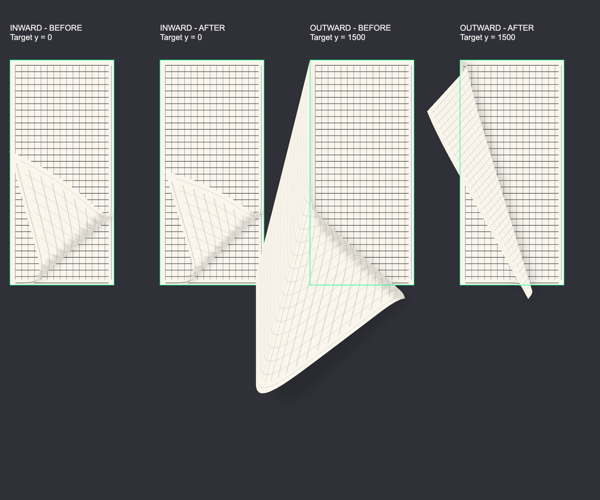
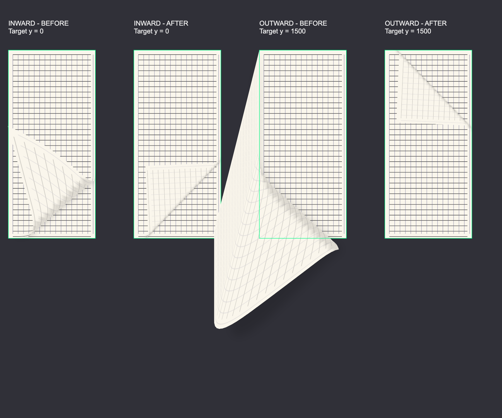
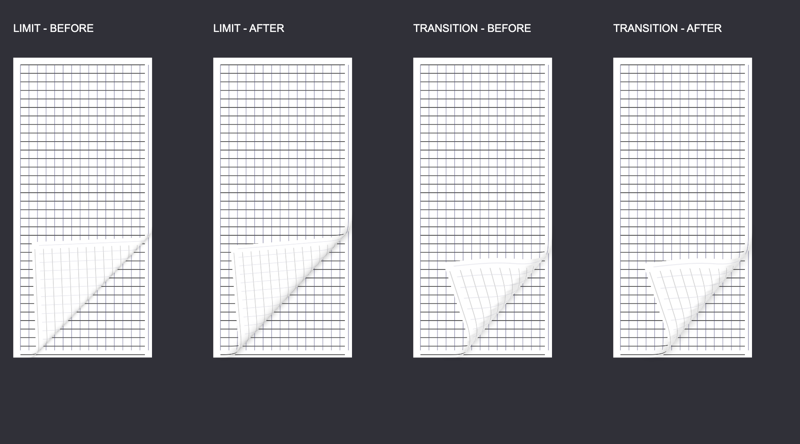

# 真实纸张翻书效果：阶段评估与方案决策

日期：2026-10-30；最近更新：2026-11-03。状态：默认后端已确定，Apple Books 曲面与材质对照进行中，尚未接入正式阅读器。

2026-10-31 补充 Apple Books 真机自动参考采集流程（第 8 节），以及同纹理材质、局部页角和回折轮廓迭代（第 9 节）。这些补充不改变已有后端选择，也不表示完成了 Apple Books 视觉等价验收。

## 1. 阶段结论与采用方案

当前保留 **Flutter 网格、Flutter fragment shader 两个可交互后端**，共用页面来源、纹理缓存、手势和页码流转。自动模式按平台选择默认后端，用户可以在原型界面覆盖该选择。

| 平台 | 自动模式的默认后端 | 决策依据与边界 |
| --- | --- | --- |
| iOS | 网格 | iPhone 12 上网格的持续拖动 P95 和 raster 尾部表现更好；仍存在首拖长尾。 |
| macOS | 网格 | 用户确认优先保持纸面与文字采样的一致体验。M5 Pro 上 shader 实际更快，但曲面文字与光影仍有画质取舍。 |
| Android | Flutter shader | 延续 Redmi K70 Pro 上的原型选择；新曲面回退范围与释放长尾修复见第 9.35–9.36 节。单机结果不代表所有 Android GPU。 |
| Windows、Linux 等未验证平台 | 网格 | 保守默认，不代表已完成性能或兼容性验收。 |

“自动”是选择规则，不是第三个实现器，也不根据逐帧负载动态切换后端。普通原型默认以 `CURL_RENDERER=auto` 启动，界面提供 Auto、Mesh、Shader。选择仅在当前会话内保留；重启恢复平台默认。正式设置的持久化、入口与翻书集成留到正式阅读器接入阶段。

原生 Metal 的 Swift/MSL 原型继续留作实验档案，只能通过显式 `metal` 或 `metal-compare` 参数进入，不列入普通用户的两个后端选择，也不集成到正式平台工程。

阶段决策不表示已经达到 Apple Books 画质。最初性能收敛未包含 Apple Books 并排对照；后续同纹理真机对照见第 9 节。当前尚未通过视觉等价验收。第 9.34 节将行卷曲／顶点混合替换为固定书脊的可展开曲面，并更新释放动力学；先前各节的画面拟合数据不自动代表新模型的拟合精度。

当前已采用近水平参考配置（第 9.20 节）、受限中线斜拖张角（第 9.25 节）以及早期折线／向外局部性修正（第 9.27 节）。这是已采姿态范围内的接近原型，仍不构成整体视觉等价。最新匿名采用记录见 [early-outward-profile-validation.json](../tool/page_curl_lab/results/books-matched-textures/early-outward-profile-validation.json)。

后翻现采用同机校准的整页自由边配置（第 9.29 节），见 [backward-free-edge-validation.json](../tool/page_curl_lab/results/books-matched-textures/backward-free-edge-validation.json)。接管恢复已做真机检查，释放／再触摸的动态时序尚未与 Books 等价。

## 2. 目标、覆盖范围与验证设备

目标是评估接近真实纸张的页角、书脊、纸背透色、光照与投影，统一用于文字、漫画和 PDF，并覆盖单页、双页与 RTL。先验证独立原型，再决定正式实现；本轮没有修改正式阅读器的行为。

| 环境 | 用途 | 可支持的结论 |
| --- | --- | --- |
| Redmi K70 Pro，Android 16，Impeller/Vulkan | 网格优化、shader 对照、实书与注入拖动、纹理缓存验证 | 该 Android 设备上的可行性与性能趋势；不等于原生硬件触摸到屏幕延迟。 |
| iOS 模拟器，手机与平板布局 | 启动、布局、翻页、取消、RTL 与单双页恢复 | 功能与布局；不能替代真机性能数据。 |
| iPhone 12，iOS 27.0.1，60 Hz，profile | 实书、网格/shader、原生 UIKit 拖动、首拖诊断、原生 Metal 对照 | 该 iPhone 上的软件绘制链路表现；不外推 120 Hz 或所有 Apple GPU。 |
| Apple M5 Pro，macOS 27.0.1，profile | 网格/Flutter shader、网格/原生 Metal、实书功能矩阵 | 该 Mac 上的实现比较；未覆盖 Intel Mac 或其他 Apple 芯片。 |

Flutter 版本为 3.47.8。实书阶段使用已授权的 EPUB、CBZ、PDF 输入。EPUB 使用一个选定章节和正式分页能力；没有完成整本跨章节、所有 PDF 内容类型或大规模书库验收。

原书、书名、书籍绝对路径、设备标识、签名信息和本轮私有实书截图不写入报告或新归档。结果索引只指向匿名 JSON。较早的合成素材截图不作为真实书籍或最终画质的证据。

## 3. 三条技术路径的区别

| 路径 | 每帧主要工作 | 接入方式与取舍 |
| --- | --- | --- |
| Flutter 网格 | Dart 更新 96×48 网格、三角形遮挡次序及光影数据，Canvas 绘制 | UI 线程承担几何工作，最终由 Impeller 使用 GPU 光栅化。曲面文字采样在本次 macOS 检查中更平滑。 |
| Flutter fragment shader | Dart 更新少量参数，GPU 逐像素解析反求纸面坐标、采样和计算阴影 | 仍在 Flutter/Impeller 的 Canvas 路径中，不经过外部纹理桥接。减少 CPU 几何工作，但逆映射、采样与光影存在近似和画质差异。 |
| 原生 Metal | 静态网格在 GPU 顶点阶段变形，硬件深度测试；多阶段投影、模糊与纸面绘制 | GPU 完成后发布 CoreVideo 外部纹理，Flutter 再合成。降低 Flutter UI 工作，但当前同步与呈现链路延迟更高。 |

Apple 平台上的 Impeller 本身已经使用 Metal。这里比较的不是“软件绘制与硬件加速”，也不是仅把着色器换成 MSL 就能自动得到加速。必须比较包含绘制、同步、纹理获取和 Flutter 合成在内的完整路径。

两种 Flutter 后端使用相同的已准备页面图片。页面排版、PDF 渲染、漫画解码与逐帧纸张变形是不同职责；当前数据不能推出“必须把书籍渲染搬到 native”。若未来继续原生路线，应优先研究翻页的帧驱动与呈现方式，而不是无依据地重写书籍格式渲染。

## 4. 评估与优化经过

### 4.1 网格、页角、书脊与光影

从整帧生成复杂网格的路径，逐步收敛为可复用的固定拓扑、顶点缓冲与排序工作区；减少高频临时对象、重复计算和页面无关工作。保持单一纸面几何模型，覆盖页角牵拉、书脊锚定、正反面与 RTL。

优化曾在同进程纯绘制记录测试中减少约 17%–21% 的中位 CPU 时间；数值检查覆盖 50,000 个顶点，位置误差为 0、量化明暗不变。但实际帧 P95 并没有每次都改善，因此不能把纯 CPU 记录收益等同于用户可见帧收益。见[网格优化对照](../tool/page_curl_lab/results/optimized-v4-android-redmi-k70-pro/comparison.json)。

随后修正近平放端点的阴影突现，以纸张高度平滑淡入淡出，并保留中段投影。iOS 六组功能矩阵已回归。见[端点阴影验证](../tool/page_curl_lab/results/ios-shadow-endpoint-fade/functional-matrix.json)。

### 4.2 页面纹理、相邻页预加载与真实来源

- 单页窗口只需要当前页与相邻页两张纹理，双页需要四张；按窗口固定可见页，减少无效页面准备。
- 通过有预算的纹理缓存加载相邻页；手机 RGBA 缓存预算 32 MiB，桌面 64 MiB。每页纹理像素上限分别为约 100 万、200 万，而不是保证全屏原生分辨率。
- 使用真实 EPUB 正式分页、CBZ 页面和 PDFium 页面验证，避免用静态合成图代表文件解码与排版。
- EPUB 页面捕获宿主只在生成纹理时绘制，避免阅读动画期间持续重绘隐藏正文。
- 同一本书在单双页切换时保留文件会话，仅重新布局和生成纹理。它改善的是准备时间，不是暖态翻页耗时，也不能当作动画性能收益。

实书验证及边界见[Android 实书汇总](../tool/page_curl_lab/results/real-books-android-redmi-k70-pro/summary.json)、[双面窗口对照](../tool/page_curl_lab/results/two-face-window-android-redmi-k70-pro/comparison.json)、[文件会话复用评估](../tool/page_curl_lab/results/session-reuse-android-redmi-k70-pro/summary.json)。

### 4.3 Android：保留 shader 为默认候选

Redmi K70 Pro 的同进程网格/shader 对照使用共同纹理、匹配视口、交错执行并丢弃暖机。此组为合成文字、PNG 和简单 PDF 素材，不能与后续实书准备时间直接混合比较。

| P95 指标 | 网格 | 当时的 Flutter shader |
| --- | ---: | ---: |
| UI 耗时 | 5.006–5.630 ms | 1.243–1.785 ms |
| raster 耗时 | 4.569–7.711 ms | 2.554–3.158 ms |
| 注入事件→raster 完成 | 16.152 ms | 13.469 ms |

之后继续改进纸缘像素覆盖、透视折线位置、接触阴影、投影和预热。实书六组与跨页拖动验证证明该路径可用，但不同批次仍出现 raster 长尾，不能宣称稳定 120 Hz。

Android 跟踪中，某些慢帧主要等待在 `QueuePresentKHR`、`queueBuffer`、`waitForever`；平面绘制也会出现等待。这说明只优化卷曲公式不能解释全部长尾；尚未确认底层驱动或合成器根因。

证据：[网格/shader 初始对照](../tool/page_curl_lab/results/shader-route-android-redmi-k70-pro/comparison.json)、[shader 细化与预热](../tool/page_curl_lab/results/shader-refinement-android-redmi-k70-pro/comparison.json)、[原生 raster 跟踪摘要](../tool/page_curl_lab/results/session-reuse-android-redmi-k70-pro/native-raster-summary.json)。

### 4.4 iOS：网格、shader、首拖与预热

iPhone 12 的实书同进程网格/shader 对照中，网格把更多工作放在 UI 线程，但 raster 尾部显著低于 shader。代表性单页配对数据如下；该组不是完整单双页性能矩阵。

| P95 指标 | 网格 | Flutter shader |
| --- | ---: | ---: |
| raster 耗时（三种格式） | 1.474–1.538 ms | 14.693–18.247 ms |
| 原生 UIKit 拖动分发→raster 完成 | 19.707–21.545 ms | 25.937–26.231 ms |

原生拖动使用五次前翻、两次后翻和短回弹，三种格式最终页码正确。输入数据是分开构建/运行的对照，不是同进程随机配对试验。

首拖仍出现过百毫秒级长尾。诊断把一例分解为 raster 127.774 ms、build 2.771 ms；后一帧同时出现排队等待。通过在输入前以真实目标尺寸离屏绘制接近端点及中段，部分冷绘制工作被提前。受控清理只针对独立测试 App 自身缓存，未改设备全局缓存。

预热没有消除所有尾部：后续 Metal 对照中的网格首拖仍出现分发到 raster 完成 120.926 ms，其中 raster 100.286 ms。不能把单次最大值下降当作稳定冷启动结论，也不能称为已定位某一具体驱动操作。

证据：[iPhone 网格/shader 与原生拖动汇总](../tool/page_curl_lab/results/ios-iphone12-profile/summary.json)、[同进程性能原始结果](../tool/page_curl_lab/results/ios-iphone12-profile/mesh-shader-comparison.json)、[首拖与预热分组](../tool/page_curl_lab/results/ios-mesh-first-drag/summary.json)。

### 4.5 原生 Metal：计算负担下降，当前桥接路径不采用

独立 iOS/macOS 宿主共用 Swift/MSL 核心：静态 96×24 网格、GPU 顶点变形、硬件深度、4× MSAA、投影模糊与接触阴影。支持时使用 memoryless 深度/MSAA 附件，输出缓冲池有界。Dart 单个渲染请求在途，合并中间状态，保留最终状态；GPU 完成后才允许 Flutter 获取纹理。

两平台均使用真实三格式、单双页，共 12 组网格/Metal 对照。下面比较的是**后端请求→Flutter raster 完成 P95**，不是触摸到屏幕：

| 设备 | 网格 | 原生 Metal 外部纹理 |
| --- | ---: | ---: |
| iPhone 12 | 5.486–5.872 ms | 19.072–19.245 ms |
| M5 Pro Mac | 4.750–5.123 ms | 18.081–22.777 ms |

Metal 的原生命令执行 GPU P95 在 iPhone 上约 7.765–8.421 ms，Mac 上约 1.623–1.741 ms。Flutter UI/raster 耗时下降，但不能只看这些子指标宣布整条路径更快。

同一原生 UIKit 拖动序列的单页 EPUB 结果：网格分发到 raster 完成 P95 为 21.175 ms，Metal 为 35.248 ms。两者最大值分别为 120.926、83.213 ms；每个后端只有一轮，不能据此判断冷长尾可靠性。

六组功能矩阵在两平台均通过，Flutter 外部纹理合成与原生输出 RGB MAE 为 0。端点接近网格参考不代表中段完全等价。

内存上，Metal 自有纹理的保守池上限估算约为 iPhone 49–57 MiB、Mac 67–70 MiB；不是精确常驻值。不能把累计 `CVPixelBuffer` 包装对象数量当作并发缓冲数量或泄漏证据。整个 Metal device 分配量和进程 RSS 均包含其他子系统。

阶段结论：保留原型，暂不迁移。若重新评估，先查纹理发布、帧驱动与呈现时序，不能通过提前发布未完成的 GPU 输出“优化”数据。

证据：[Metal 总评估](../tool/page_curl_lab/results/metal-apple-prototype/evaluation.json)、[iOS 配对结果](../tool/page_curl_lab/results/metal-apple-prototype/ios-profile.json)、[macOS 配对结果](../tool/page_curl_lab/results/metal-apple-prototype/macos-profile.json)。

### 4.6 macOS 补测：Flutter shader 更快，默认仍选网格

本轮补齐了此前缺少的 **Flutter 网格与 fragment shader 直接对照**。它与原生 Metal 对照是不同实验，不能混为同一路径。

M5 Pro，profile，1000×600 逻辑视口，DPR 2，无缩放。真实三格式、单双页，交错执行，共 12 组，每组 156 帧，总计 1,872 帧。每组的页面图片共用，暖态采样排除书籍打开和页面准备。

| P95 指标 | 网格 | Flutter shader |
| --- | ---: | ---: |
| UI 耗时 | 2.186–2.762 ms | 0.563–0.711 ms |
| raster 耗时 | 2.089–2.765 ms | 1.110–1.327 ms |
| 绘制入口→raster 完成 | 4.062–4.942 ms | 1.502–1.774 ms |

两后端各六组功能检查通过，覆盖真实来源、纹理分辨率、按钮与拖动前后翻、短回弹、上下页角取消、反向取消、RTL 和恢复后页面像素一致。功能检查使用 820×700 视口，不能把它冒充为 1000×600 的交互性能采样。

并排查看 EPUB 双页下页角与漫画双页上页角后，shader 的曲面文字锯齿更明显，投影与纸面光照也有差异。对 16 位 PNG 统一到 8 位 RGB 后，端点全图 MAE 为 0–0.010，卷曲/页角为约 0.821–2.465。全图均值不能证明局部文字采样质量相同，也不是画质评分。

因此，**“Mac 默认网格”是本次确认的画质与一致性取舍，不是性能胜出**。保留 shader 供用户切换；若将来优先提升性能，应先改善其曲面采样、抗锯齿与光影，再重新评估。

证据：[macOS 网格/shader 总评估](../tool/page_curl_lab/results/macos-mesh-shader-comparison/evaluation.json)、[12 组性能结果](../tool/page_curl_lab/results/macos-mesh-shader-comparison/benchmark.json)、[匿名画面差异](../tool/page_curl_lab/results/macos-mesh-shader-comparison/visual-comparison.json)。

## 5. 统一测量口径与不能推出的结论

1. **Flutter build/raster 时间是阶段墙钟时间。** raster 不是独立 GPU kernel 时间，也不能简单相加后当作触摸延迟。
2. **帧预算超限不等于实测掉帧率。** 未验证显示呈现的 120 Hz 稳定性。
3. **输入分发、平台事件和显示扫描不是一个时间点。** iOS 事件时钟与 Flutter 时钟原点不一致时拒绝伪数据；采用 Dart 分发到匹配 raster 完成的指标，不包含分发前系统输入队列、合成呈现与屏幕扫描。
4. **原生 Metal 与 Dart 的时钟需要校准。** 通过采样前后多次请求/回复求偏移区间交集；只有整个原生纹理获取时间误差区间落在唯一一帧 raster 区间内才匹配。未匹配、未观测及合并的更新数量保留在匿名结果中。
5. **后端请求的起点要说明。** Canvas 从 `CustomPainter.paint` 入口开始，Metal 从原生调用前开始；这两个起点之前的框架工作并不完全相同。原生触摸对照作为另一组证据，不能与自动动画的后端延迟混成一个指标。
6. **内存指标有边界。** RGBA 账本不包含解码器、PDF、平台或 GPU 的全部分配；RSS 是整个进程。短时间翻页采样不证明长期无泄漏。
7. **暖态、首次绘制和来源准备需要分开。** 缓存复用不能掩盖冷加载成本，文件会话复用的收益也不能归到逐帧翻页。
8. **按实验内部配对比较。** 不把不同视口、版本、素材、缓存状态或设备的最优数字拼成统一胜率。模拟器不提供真机性能结论。

## 6. 原型的交互与运行方式

平台策略位于 [renderer_selection.dart](../tool/page_curl_lab/renderer_selection.dart)，界面和生命周期位于 [main.dart](../tool/page_curl_lab/main.dart)。

- 普通启动默认为 `CURL_RENDERER=auto`。iOS、macOS 自动选网格，Android 自动选 shader。
- 用户选择 Mesh/Shader 后，不重开书籍、不重新分页、不替换当前页面纹理，保留页码、单双页与方向。选择在切换书籍来源和布局后仍保留于当前会话。
- 翻页、拖动或页面准备期间禁止切换，避免中途变更管线。shader 在需要时加载与预热；失败后显示错误，保留原选择与页面，仍可继续翻页。
- `mesh`、`shader` 用于强制单后端实验；`compare` 用于 Flutter 两后端交错对照。显式实验参数不提供普通自动选择入口，避免采样中误切后端。
- `metal`、`metal-compare` 仅用于原生 Metal 实验；普通原型菜单不展示它们。

macOS 复用 [run_metal_macos_lab.py](../tool/page_curl_lab/run_metal_macos_lab.py)；文件名保留历史兼容性，默认使用 `auto`，现已支持 `--renderer auto|mesh|shader|compare|metal|metal-compare`。先用 [prepare_metal_lab.py](../tool/page_curl_lab/prepare_metal_lab.py) 准备仓库外的独立宿主，再传入 `--lab-directory`、`--epub`、`--cbz`、`--pdf` 和仓库外 `--output`：

- `--mode preview --renderer auto`：可交互原型与普通选择入口。
- `--mode benchmark --renderer compare`：Flutter 网格/shader 12 组暖态对照。
- `--mode smoke --renderer mesh` 或 `shader`：各六组功能检查。
- `--mode smoke --renderer auto`：平台默认、运行时覆盖/恢复、复用当前纹理，以及六组功能检查。
- `--mode benchmark --renderer metal-compare`：保留的原生 Metal 实验。

脚本检查独立宿主身份、入口引用和仓库边界，拒绝在正式平台工程内执行实验。书籍与日志由调用者提供并保留在仓库外；命令示例不保存个人路径。iOS 仍使用独立签名测试 App，保持亮屏仅限该 App 前台，不修改设备全局休眠配置。

## 7. 验证记录与下一阶段边界

历史关键提交：`6b6bdff` 实书验证、`c98a1e0` iOS 预绘制及首拖诊断、`8746b63` 阴影端点过渡、`3b3da84` Apple Metal 原型与匿名对照。macOS Flutter shader 补测和本次策略收敛在这些结果之上进行。

本次收敛补充了平台默认和显式覆盖的规则测试，以及切换保留页码/纹理/方向、布局变化保留选择、加载失败恢复等交互测试。收敛后的静态检查、174 项 Flutter 测试、6 项 Python 测试及 Python 编译检查通过。macOS 自动默认、运行时覆盖/恢复、当前纹理复用及六组实书回归通过，见[选择入口功能验证](../tool/page_curl_lab/results/platform-selection/macos-functional.json)。iOS 新选择入口通过 Widget 测试的平台变体验证，未在 iPhone 上重新执行入口交互；前述 iOS 实书/原生触摸数据仍按各历史实验单独引用。

下一阶段正式接入时再处理：

- 将两个后端接入正式阅读会话，复用格式专属 locator 与现有进度机制，不让漫画页码替代 EPUB/PDF 的位置模型。
- 在阅读设置保存 Auto/Mesh/Shader 用户选择，沿用本报告的平台默认；不要把原生 Metal 作为普通选项。
- 明确正文选择、链接、放大、连续阅读和翻页手势的冲突边界，并补全失败、取消、页面失效和窗口重排恢复。
- 优先验证 iOS 网格首拖长尾，以及 shader 曲面文字采样与抗锯齿。没有证据时不继续堆叠微优化。
- 扩展其他 GPU、平板、120 Hz、较长会话、持续内存和温升验证，再决定是否调整默认。

本阶段不包含正式阅读器接入、正式设置持久化、原生呈现链路重写、Apple Books 视觉等价承诺或长期性能认证。性能路径的阶段取舍在此收敛；后续视觉迭代见第 9 节。历史原始结果保留，新的平台决策以本报告为准。

## 8. Apple Books 真机自动参考采集

### 8.1 目标与已验证结果

继续逼近 Apple Books 的纸张质感，先建立可重复的页角拖动、纸背、文字采样与阴影参考。第三方 `real_page_flip` 留作后续阅读器缓存、手势仲裁和状态恢复的参考，本轮没有引入该依赖或替换现有渲染后端。

本轮使用 iPhone 12、iOS 27.0.1、Xcode 27.1，以及仓库外隔离安装的 Appium 3.9.0、XCUITest Driver 12.22.7、WebDriverAgent 16.17.6。Node 为 26.13.0。这些是已测环境，不代表其他版本已验证。

- 本机 macOS Books 9.0 的采样呈现平移叠页，没有取得纸张卷曲参考；当前已启动的 iOS 模拟器未安装 Books。因此使用真机 Books。
- 常规原生 XCTest 和 WDA 的 `xcodebuild` 启动都在握手阶段失败，测试运行器退出码为 74。已通过的绕行路径为：签名并预装 WDA → 建立 RemoteXPC 隧道 → 使用 `usePreinstalledWDA` 创建会话。尚未确认常规路径失败的底层根因。
- `devicectl` 可以截图，但该设备拒绝其 Screen Recording 能力；打通 WDA 后，XCTest 录屏能够开始、拉取并保存视频。
- 最终从外部 capabilities 文件自动新建会话，执行慢拖翻页和拖回取消，保存截图、录屏与结果，结束自己创建的会话。人工拖动不再是采集前提。
- 最终真机验收中，截图页码经本机 Vision OCR 核对为 `4 → 5 → 5`，取消前后 PNG 完全一致；请求 30 fps，产出约 12.7 秒的可解码视频。抽帧检查确认包含真实页角卷曲和退回过程。此前另一轮核对为 `5 → 6 → 6`。

私有截图、录屏、capabilities、签名信息和设备标识保留在仓库外，不随本报告提交。本轮没有进行相同视口、相同排版和相同抓取位置下的原型配对验收，不能据此宣称画质等价。

### 8.2 采集入口与前置条件

入口为 [capture_books_reference.py](../tool/page_curl_lab/capture_books_reference.py)，仅依赖 Python 标准库，通过本机 Appium 服务访问 Books。它不负责安装 Appium/WDA、导入书籍、选择章节或配置阅读主题；执行前需在 Books 打开已授权的测试 EPUB，启用卷曲，并准备好要对照的单页阅读状态。后续采集会沿用该状态，并实际推进一个阅读页。

准备仓库外的 capabilities JSON。以下占位值需按实际设备、签名和 WDA 构建目录填写，不把替换后的文件提交仓库：

```json
{
  "platformName": "iOS",
  "appium:automationName": "XCUITest",
  "appium:udid": "<device-udid>",
  "appium:platformVersion": "27.0.1",
  "appium:usePreinstalledWDA": true,
  "appium:prebuiltWDAPath": "<external-wda-build>/Build/Products/Debug-iphoneos/WebDriverAgentRunner-Runner.app",
  "appium:updatedWDABundleId": "<signed-wda-bundle-id>",
  "appium:xcodeOrgId": "<team-id>",
  "appium:xcodeSigningId": "Apple Development",
  "appium:newCommandTimeout": 600
}
```

隧道与 Appium 就绪后，在仓库根目录运行：

```bash
capture_root="$(mktemp -d /tmp/fbooks-books-capture.XXXXXX)"
python3 tool/page_curl_lab/capture_books_reference.py \
  --capabilities "$HOME/.cache/fbooks-ios-automation/session-capabilities.json" \
  --output "$capture_root/run"
```

也可传入 `--session-id <existing-session-id>` 复用现有会话；与 `--capabilities` 二选一，复用的会话不会被脚本关闭。Appium 默认地址为 `http://127.0.0.1:4731`，可用 `--appium-url` 指定其他本机地址。`--fps` 范围为 1–60，默认 30。

脚本只接受本机 Appium 地址，拒绝把解析符号链接后的输出目录或 capabilities 放进仓库；输出必须为尚不存在的新目录，避免混用旧截图。它强制使用 Books、`noReset` 和 `shouldTerminateApp: false`，不重置书库，结束时保留 Books。

### 8.3 当前工具环境的启动与恢复

当前外部工具目录为 `~/.cache/fbooks-ios-automation`，不是仓库交付物。原 `/tmp/fbooks-ios-automation` 在清理后已不可用；2026-11-03 从 npm 缓存和既有已签名 WDA 恢复，改用专用缓存目录。设备标识与签名配置仍只在仓库外保存，目录权限为 700，capabilities 为 600。目录中的依赖、已签名 WDA、capabilities 和启动辅助脚本在本机验证过；其他机器检出仓库后不会自动具备它们。首次搭建或该目录被清理后，需要重新隔离安装上述版本的 Appium/XCUITest Driver、注册驱动、以本机开发团队签名构建 WDA，并生成外部配置和启动辅助脚本。

当前目录仍完整时，恢复顺序为：

1. 连接已配对的目标 iPhone；确认开发者模式、开发签名信任与 UI 自动化条件，必要时人工解锁。采集脚本不绕过设备锁屏，也不修改全局自动锁定设置。
2. 在终端运行 `~/.cache/fbooks-ios-automation/start-device-tunnel.sh`。它通过 `sudo` 为指定设备创建临时 RemoteXPC 隧道，注册服务仅监听 `127.0.0.1:42314`；管理员密码只在本机终端输入，保持该终端运行。
3. 若 Appium 尚未运行，在另一终端启动：

   ```bash
   AUTOMATION_DIR="$HOME/.cache/fbooks-ios-automation"
   APPIUM_HOME="$AUTOMATION_DIR/home" node \
     --import "$AUTOMATION_DIR/isolate-storage.mjs" \
     "$AUTOMATION_DIR/node_modules/.bin/appium" \
     --address 127.0.0.1 --port 4731
   ```

   本机生成的 `isolate-storage.mjs` 将 XCUITest 的 strongbox 存储重定向到同一外部目录，使管理员隧道进程和普通用户的 Appium 读取同一注册记录，不依赖各自用户目录。重建环境时需同时恢复这一约定；不能只启动一个写入管理员默认目录的注册服务。
4. 确认 Books 阅读状态，然后运行第 8.2 节命令。设备重连后应重新检查隧道记录；临时启动脚本只绑定生成时的设备，换设备须重新配置，不应直接复用。

安装与协议前置条件参考 [XCUITest Driver 安装](https://github.com/appium/appium-xcuitest-driver/blob/master/docs/getting-started/installation.md)、[预装 WDA](https://github.com/appium/appium-xcuitest-driver/blob/master/docs/guides/run-preinstalled-wda.md)和 [RemoteXPC 隧道](https://github.com/appium/appium-xcuitest-driver/blob/master/docs/guides/remotexpc-tunnels-real-devices.md)。隧道需要管理员权限是该工具创建 TUN/TAP 接口的要求；后续每次采集不需要人工拖动，但重启、断线或锁屏仍可能需要恢复连接。

### 8.4 输出、断言与视觉结论边界

输出包括 `before-forward.png`、`after-forward.png`、`after-cancel.png`、`forward-cancel.mov` 和 `result.json`。脚本按视口比例生成四段轨迹，每段移动 1.3 秒，再以同坐标 `pointerMove` 保持 2.2 秒；完成翻页后执行返回起点再抬手的取消。`result.json` 的 `forward_trace` 记录实际发出的整数坐标和停驻方式。会话、录屏和截图失败均记为失败，不因成功发出动作命令就判定验收通过。

`passed` 要求翻页前后 PNG 不同、取消后恢复到取消前的同一 PNG，并取得可保存的视频响应。这是严格的画面断言：书籍已到末页、控件未隐藏、状态栏时间变化或系统提示都可能导致失败，必须检查产物，不能把它等同于格式专属 locator 或页码语义断言。自动脚本没有执行 Vision OCR，前述页码核对属于本轮额外验证。它也不自动证明视频包含卷曲，仍需解码、抽帧检查。

参考画面中，浅色纸背接近中性白，带淡镜像文字，卷曲周围有较宽的柔和投影；采集时的原型有固定暖色纸背，后续已参数化纸色并调整投影，见第 9 节。采集参考本身不代表已完成渲染修复。几何比较仍需控制抓点和拖动轨迹；录屏用于画质取样，不作为原生触摸到显示延迟或性能基准。

本轮新增脚本通过 Python 语法检查，仓库内输出、符号链接指回仓库和远程 Appium 地址的拒绝检查通过；真机复用会话和新建会话的采集均通过。`flutter analyze` 与 174 项 Flutter 测试通过。


## 9. Books 同纹理对照与曲面迭代（2026-10-31）

### 9.1 方法与独立入口

使用 [reference_capture.dart](../tool/page_curl_lab/reference_capture.dart) 作为仓库外独立 Flutter 宿主的入口。调用者把 Books 的三张相邻页截图复制为该测试 App 的 `Documents/reference-0.png`、`reference-1.png` 和 `reference-2.png`。图片必须与设备完整视口的像素尺寸一致；本轮为 390×844 逻辑像素、DPR 3。入口隐藏系统覆盖层并直接绘制截图纹理，不重新排版、不打开正式书库。这能隔离内容和排版差异，不能代替 EPUB 解析与正式阅读器集成验证。

入口自动导出 Mesh/Shader、原米色/中性白纸背在进度 0.15、0.45、0.7 的 PNG，并运行三轮暖态动画。每轮交换两种纸色的先后顺序，两个后端顺序保持 Mesh→Shader；每组两秒。截图编码完成后先提交暖态绘制，等待 200ms 再记录帧耗时。输出位于测试 App 的 `Documents/curl-reference-results/`，包括截图和 `result.json`。采样结束后提供相同纹理的交互翻页与取消。

该入口只覆盖三张参考图和单页模式。静态进度不等于 Books 内部形变进度，原生录屏抽帧也未完成时间和形变标定；并排图只用于观察轮廓、纸背与阴影，不能当作逐像素画质评分。

### 9.2 已完成的三轮改进

- 中性纸背：Mesh 调色板与 Shader 都支持纸色参数，合成页保留原米色，普通原型的真实来源采用白纸背；预热与实际绘制使用同一纸色。白纸背不再固定偏黄，仍保留淡镜像文字。
- 局部页角与接触阴影：远侧折线延后进入纸面，未弯曲区域保持原位；接触暗部按纸面高度调整宽度与模糊。Shader 采用有界割线修正，保留可能因纵向牵拉进入视口的候选，并在圆弧/平面接缝保留 0.05 显示像素重叠，防止漏面。
- 回折轮廓：纵向位移由折线倾斜与横向回折量决定；透视距离从页宽的 5 倍改为 10 倍，避免手机下页角弧顶被下沿裁掉。书脊固定、上下页角对称、完成/取消端点连续等约束保留。

前两轮提交分别为 `3f478e5`、`da7c63c`。回折轮廓改动在本节补写时尚未提交。改动限于实验目录及其测试，未接入正式阅读器，未调整平台默认后端或默认阅读方向。

### 9.3 真机暖态结果与限制

下面每项为该阶段中性纸背三轮的 Raster P95 范围，均来自 iPhone 12、profile、相同截图纹理。三个阶段分开构建运行，不能把跨批次数字解释为严格配对的优化收益。

| 阶段 | Mesh Raster P95 | Shader Raster P95 | 匿名原始结果 |
| --- | ---: | ---: | --- |
| 中性纸背 | 1.348–1.492 ms | 7.095–13.877 ms | [paper-material.json](../tool/page_curl_lab/results/books-matched-textures/paper-material.json) |
| 局部页角与阴影 | 1.863–2.183 ms | 14.320–17.582 ms | [local-corner.json](../tool/page_curl_lab/results/books-matched-textures/local-corner.json) |
| 回折位移与较弱透视 | 1.548–1.911 ms | 7.409–20.832 ms | [recurl.json](../tool/page_curl_lab/results/books-matched-textures/recurl.json) |

这些批次中，Mesh 中性纸背各组均无 60Hz 流水线超预算采样帧；这不等于硬件呈现掉帧率为零，也不覆盖首拖、长期温升或其他设备。Shader 仍有明显尾部波动，因此继续保留 iOS 默认 Mesh。不能由当前数据证明 Shader 没有性能回归。

三个阶段均通过同一 WDA 指针轨迹的前翻与回弹取消。末轮截图核对为第 4 页→第 5 页，取消前后 PNG 完全一致。回折轮廓阶段的 `flutter analyze` 与 181 项 Flutter 测试通过；新增覆盖纸背中性、调色板恢复、未卷区域固定、远侧页角、反解露底、回折方向、端点连续及手机弧顶可见性。此次新增视觉迭代未在平板、桌面或 Android 实机上复核，既有平台结果仍按原批次引用。

### 9.4 防止复用旧进程和旧报告

重新安装测试 App 后，不能仅凭启动命令成功就认定新构建已运行。应先通过自动化终止该测试 App 的旧进程，再安装和启动。终止对象仅限独立原型，不终止或重置 Books。

采样开始即覆盖报告为 `status: running`，并写入 `capture_started_utc`；异常改为 `failed`，完成后为 `passed`。取回结果时须核对本次启动时间、完成状态和 12 组帧数，不能读到上轮的 `passed` 就提前验收。录屏和 PNG 应与同一轮报告一并保存到仓库外。匿名帧指标可以归档，原书内容、截图、视频、设备标识、签名与个人路径不得随结果入库。

### 9.5 可变张角的锥形截面近似

前述半圆模型每行卷到 180° 后接一段与底页平行的背面，容易形成宽纸带。新模型让抓取侧在圆弧之后保留一定张角，尾部沿圆弧切线继续抬起；随抓取行距离和翻页阶段平滑变化。中线拖动保持半圆截面，完成/取消端点仍回到原平面，书脊继续通过积分差固定。

张角最大减幅为 1.25 弧度，最小转角约 108.4°，始终大于 90°；按抓点偏离中线程度、抓取行邻近度和 `sin²(π × progress)` 调制。邻近度采用平方距离的平滑函数，避免抓取行的尖点让 24 行网格与解析曲面轮廓产生明显偏差。每行弧段之后沿切线延伸，是带锥形趋势的分行近似，不能称为精确圆锥或可展纸面。

Shader 同步反求倾斜尾部与圆弧，对其遮挡、材料边界和阴影高度作相应调整。离纸高度不再受旧半圆的 `2 × radius` 上限约束；新的几何验证要求高度不超过到书脊的材料弧长。纸背光照以该行尾部的朝向归一化，保留弧段相对明暗，避免改变张角就把整片白纸背染灰。

该模型尚未通过 Apple Books 视觉等价验收。后续仍需匹配抓点的二维轨迹、实际折线位置与更完整的投影，不能把一组相近阶段抽帧视为几何已对齐。


### 9.6 可变张角模型的本轮验证

同一独立 iPhone 宿主的三轮暖态结果见 [open-corner.json](../tool/page_curl_lab/results/books-matched-textures/open-corner.json)。每个后端和纸色共三组、每组 121 帧。中性白纸背的 Mesh Build P95 为 3.758–3.772ms，Raster P95 为 1.556–1.946ms，三组均无 60Hz 流水线超预算采样帧；Shader Raster P95 为 14.022–17.540ms，超预算采样帧比例为 4.13%–7.44%。这是当前单机暖态结果，不是丢帧率，也不证明相比上一阶段存在严格配对的性能收益。平台默认保持不变。

同纹理观察中，抓取侧尾部由大段平行底页的纸背变为抬起的斜面，外角轮廓能留在页面内；纸背亮度归一化后不再因新张角整体变灰。Books 的卷曲半径分布、二维抓点约束和投影仍未匹配，当前不能称为视觉等价。

`flutter analyze` 和 184 项 Flutter 测试通过。新增规则验证抓取侧尾部继续抬起、中线保持圆柱截面、纸背亮度；解析曲面覆盖检查扩展到上下页角的 0.15、0.45、0.7 三个阶段。现有书脊固定、平放区域、上下镜像、端点连续、单双页和 RTL 检查保留。高度约束改为不超过到书脊的材料弧长，适配倾斜尾部，并非跳过原有有限性检查。平板、桌面与 Android 未重新做实机视觉和性能验收。

最终构建再次通过相同 WDA 指针轨迹：第 4 页翻到第 5 页，随后拖回取消，取消前后 PNG 完全一致；对应录屏和截图保留于仓库外。


### 9.7 前翻的二维抓点约束

此前按横向位移除页宽直接设置曲面进度，而抓取高度只在横拖识别后取一次。该映射不等于纸张材料点的移动比例，也没有使用拖动过程的纵向位置。新 [curl_drag.dart](../tool/page_curl_lab/curl_drag.dart) 使用按下时的真实材料抓点：先在固定抓取行反求横向进度，再按透视后的纵向目标反求折线倾斜。两种 Flutter 后端接收相同的倾斜参数，松手后的形变随动画回到端点。

完成/取消仍按原有拖动距离和速度判断，与反求出的曲面进度分离，避免慢拖超过半页却回弹。输入先还原双页偏移和 RTL 镜像；接入覆盖普通原型和同纹理入口的前翻。后翻、非活动页区域发起的拖动和原生 Metal 实验仍沿用既有映射；近乎竖直的轨迹对倾斜幅度作有界限制，超出范围时不承诺材料点精确跟随。

Shader 对较大倾斜按误差阈值提前结束反解，最多进行十一次纵向修正；最终材料边界也检查横坐标。强倾斜的覆盖检查使用加密参考网格，并排除三显示像素的轮廓采样边带，断言完整纸背内部不露底；该检查不能证明两种后端的轮廓抗锯齿逐像素一致。

独立宿主以 `--dart-define=CURL_POINTER_CAPTURE=true` 构建时，输出改为 `Documents/curl-reference-pointer/`。输入从 `(373,732)` 沿轨迹到 `(48,645)`，固定取样点按 WDA 整数坐标设为 `(292,710)`、`(211,689)`、`(129,667)`。`linear-` 前缀图片使用同一曲面、同一原始起点下的“横向位移除页宽”基线，普通图片使用二维反求；两者只比较映射，不能把整条轨迹完成比例误当作旧进度。暖态采样每帧包含反求开销，输出注明 `pose_input: pointer-trace`，不能与第 9.3、9.6 节的标量动画直接拼成性能胜率。

Books 与交互原型都发出了相同的四段指针轨迹，每段请求移动 1.3 秒并 `pause` 2.2 秒，随后松手；再执行拖出并返回起点的取消。但后续原始 `PointerEvent` 记录确认，当前 WDA/XCTest 会跨中间 `pause` 继续插值：前三个目标仅短暂经过，只有抬手前的最后一个目标真正停驻。因此旧录屏抽帧不能作为严格同位置参考，据此拟合的曲面参数已恢复至上一版基线。图片、视频和自动化环境仍保留在仓库外。


本轮三处模型抓取点投影误差均小于 0.00002 逻辑像素（报告字段 `anchor_error_pixels`），这是同一数学模型内的约束残差，不是 GPU 像素定位精度、硬件触摸精度或触摸到显示延迟。对应曲面进度约为 0.152、0.278、0.498，而旧横向位移映射约为 0.208、0.415、0.626，不能把前者直接代入松手阈值。

包含反求的三轮中性纸背暖态结果：Mesh Build P95 为 3.711–3.745ms，Raster P95 为 1.932–2.126ms，无 60Hz 流水线超预算采样帧；Shader Raster P95 为 7.930–14.052ms，超预算采样帧比例为 1.65%–2.48%。每组 121 帧，原始匿名报告见 [pointer-trace.json](../tool/page_curl_lab/results/books-matched-textures/pointer-trace.json)。这些数字不证明跨批次性能胜出，也不覆盖首拖或其他设备。

Books 与交互原型都核对为第 4 页→第 5 页→取消后第 5 页，取消前后 PNG 一致，匿名断言见 [pointer-validation.json](../tool/page_curl_lab/results/books-matched-textures/pointer-validation.json)。静态检查与 189 项 Flutter 测试通过；新增验证二维材料点约束、坐标还原、往返/越界、只移动纵向时的界面更新，以及曲面进度不足一半时仍按原手势阈值完成。此次新映射未在 Android、平板、桌面做实机验收。

二维反求保证模型内材料抓点跟随目标，但尚不能据旧采集判断其与 Books 的视觉接近程度。后续须先通过原始触摸事件验证停驻语义，再重采同位置参考，匹配完整折线、回卷半径、纸角和投影。不能用模型抓点残差替代画质验收，也不能把请求中的 `pause` 时长视为设备实际停驻时长。

### 9.8 实际停驻校验与中线张角（进行中）

自动化动作改为连续的同坐标 `pointerMove`，在原型外层记录原始 `PointerEvent`。三处目标的事件间隔分别为约 2.225、2.208、2.208 秒，间隔内触点保持在目标位置，确认停驻成立后重新采集 Books。匿名校验见 [input-holds.json](../tool/page_curl_lab/results/books-matched-textures/input-holds.json)。Books 取消前后均为第 4 页；整张 PNG 不同，人工核对差异来自系统 Home 指示条显隐，不能将其记为 PNG 完全一致。

视频按零时间容差提取停驻区间，另外补采下页角水平、强斜拖、中线、上页角水平、上页角斜拖和短距离六种轨迹。新参考说明中线拖动也保留张角，原型此前强制中线为 180° 半圆，造成过宽纸背。当前候选让中线截面沿纵向一致，页角再按抓取行距离改变张角和半径；完成动画末段平滑收平。Mesh 和 Shader 共用曲面参数，强倾斜 Shader 使用多初值反解并检查正向投影误差，避免只增加迭代次数后误选交点。

Mesh 的投影改为逐顶点按高度投到底页，用实际抬起三角形的合并覆盖生成阴影；不再按全页最高点平移整个轮廓。Shader 的阴影仍为解析近似，不能据此宣称两后端的投影已一致。当前候选的投影宽度、底边弧顶及局部文字曲率仍与 Books 有差异；轮廓拟合只用于候选筛选，尚未达到视觉验收，不采用拟合分数作为完成结论。相关画面、原始事件与探索脚本均保留在仓库外。

中线张角候选首批 iPhone 暖态三轮中性纸背采样中，Mesh Build P95 为 3.847–4.330ms、Raster P95 为 1.875–2.204ms，每轮 121 帧，未采到 60Hz 流水线超预算帧。Shader Raster P95 为 31.819–33.116ms，超预算采样帧比例约 45.3%–49.6%，仍有明显性能问题。匿名原始报告见 [open-center.json](../tool/page_curl_lab/results/books-matched-textures/open-center.json)。这批数据早于下述面向和深度修复，不能代表其最终性能。

六种独立轨迹还发现强斜拖时的两类渲染错误：Mesh 按截面转角判断正反面，会把实际朝后的三角形画成正文；Shader 固定按分支优先级合成，则可能显示较远的交点。当前修复使用投影绕序/局部投影导数判断面向，强斜拖按实际深度选择可见交点。圆弧反解超出实根域时先回到有效区域，域内使用导数修正，避免夹值后收敛到不存在的截面。新增回归使用黑色正面、白色纸背，覆盖强斜拖及上下镜像；18 个原有姿态拆为独立用例，全部保留原覆盖和误差要求。

后续候选沿抓取行至自由页角逐渐减弱纵向牵拉，在抓取行系数仍为 1，保留二维材料抓点约束；上下页角使用连续对称的变化，中线不额外衰减。Mesh 纵向网格从 24 行增加到 48 行，减少强斜拖时的分层轮廓。近轮廓交点在 Shader 中出现约 0.023 个显示像素的浮点残差，内部交点筛选与最终检查统一采用 0.05 像素余量，纸背覆盖测试的断言保持不变。静态分析与 207 项 Flutter 测试通过。

48 行网格候选的 iPhone 三轮中性纸背暖态采样：Mesh Build P95 为 4.692–5.032ms、Raster P95 为 1.444–1.548ms，每轮 121 帧，未采到 60Hz 流水线超预算帧。Shader Raster P95 为 38.484–40.533ms，超预算帧比例约 60.2%–63.3%，仍只作为实验对照。匿名报告见 [tapered-pull.json](../tool/page_curl_lab/results/books-matched-textures/tapered-pull.json)。这些采样不覆盖全部强斜拖或首拖；尚未重新验收平板、桌面和 Android，也不代表已完成 Books 画质对齐。

### 9.9 初始页取消与源纹理校验

连续方向对照暴露了参考采集入口的状态错误：`animateTo(0)` 结束也会发送 `AnimationStatus.completed`，原入口只检查该状态，在初始页取消时错误切到下一张源纹理。第 9.7 节先完成翻页、再取消的断言仍有效，但它未覆盖初始页取消；修复前的连续六方向原型画面不能全按同一源页比较。标量/指针自动性能采样期间有独立的状态保护，不受这次意外换页影响。

入口现改为取消时 `animateBack(0)`，只有完成状态且动画值确实为 1 才推进源页。新增 Widget 回归覆盖初始页连续两次取消和真正完成后的纹理切换；静态分析与 208 项 Flutter 测试通过。独立宿主支持 `--dart-define=CURL_SAMPLE_ON_START=false` 跳过性能预采样，直接进入交互，默认仍预采样。

修复后重采六条轨迹，每次取消均校验回到初始正文。在 390×844 视口的 `[0,40,390,800]` 区域，RGB 平均绝对差全部为 0；范围排除了底部系统指示条显隐，不据此声称整张 PNG 完全一致。匿名断言见 [cancel-validation.json](../tool/page_curl_lab/results/books-matched-textures/cancel-validation.json)。几何候选还需检查弯曲文字区：仅降低灰带轮廓误差，可能同时让纸背变宽、正文过早卷入，不能作为画质改善的充分证据。

### 9.10 按抓取高度分配卷曲半径

将全局半径同时增大，虽然改善部分文字区，却破坏起卷局部性、常规斜拖的抓点约束和强斜拖面向，因此没有采用。该阶段候选只让中线使用较宽截面，半径系数从页角的 0.30 平滑插值到中线的 0.42，张角幅度从 1.16 插值到 1.20；距中线超过页面高度 1/3 时保留原有页角参数。两后端共用插值，静态分析与 208 项 Flutter 测试通过。

另外采集五个新姿态（两个页角中间位置、上下四分之一抓点和中线斜拖），并重复中线水平作为控制。Books、旧模型和新模型都使用同一 iPhone、同一纹理和指针坐标；每次取消后正文与初始页差异均为 0。弯曲文字区的截断对称 L1 距离，中线控制约从 0.954 降至 0.226 个逻辑像素，上下四分之一抓点约从 1.268/1.384 降至 1.204/1.291，中线斜拖约从 2.114 降至 1.797，页角中间位置基本一致。方法和匿名数据见 [grab-height-validation.json](../tool/page_curl_lab/results/books-matched-textures/grab-height-validation.json)。这是固定区域的辅助变形指标，不能当作主观评分、整帧像素误差或整体 Books 验收结论。

新增 `--dart-define=CURL_CENTER_CAPTURE=true` 可使用中线水平轨迹预采样，输出写入独立的 `Documents/curl-reference-center-pointer/`（同时启用 `CURL_POINTER_CAPTURE` 时）。三轮 Mesh Build P95 为 5.843–6.245ms、Raster P95 为 0.890–0.995ms，每轮 121 帧，未采到 60Hz 流水线超预算帧；Shader Raster P95 为 11.824–15.950ms，仍有约 2.48%–4.13% 超预算采样帧。见 [center-profile.json](../tool/page_curl_lab/results/books-matched-textures/center-profile.json)。不同轨迹不可直接作为性能胜率比较，页角后半程文字弯曲、纸背及折线仍未全部对齐。

### 9.11 拖动方向与后半程折线

新增四种后半程真机参考，确认 Books 的纯水平拖动更接近整页圆柱截面。原型现在根据原始指针的纵横位移比平滑启用页角权重，纯水平使用较宽截面，斜拖逐渐恢复按抓取高度分配的局部卷曲；透视补偿产生的微小倾斜不参与方向判断。权重随姿态传给几何、Mesh、Shader 和参考采样，不能只传进度与倾斜而遗漏权重。

后半程折线改用纵向四次曲线，在抓取行和远侧页缘的位移与一阶导数均为零。时间幅度同样平滑启用，抓取行和自由页角的几何保持原约束，减少正文过早卷入。该模型仍是分行近似，不宣称等距可展；仓库外的圆锥曲面实验未同时通过抓点可达性和强斜拖纸角检查，没有接入。Shader 的轮廓附近导数差分随残差缩小，修复新折线下 Newton 在有效交点附近振荡造成的漏面，未放宽像素覆盖断言。

七组同 iPhone、同纹理、同指针位置的文字区辅助距离如下。每个姿态的新旧模型使用相同采集方法：前三组为真机 `RepaintBoundary`，新增四组为录像精确抽帧。源纹理及每次取消后的正文 MAE 均为 0；匿名方法和数据见 [direction-bow-validation.json](../tool/page_curl_lab/results/books-matched-textures/direction-bow-validation.json)。

| 姿态 | 旧模型 | 新模型 |
| --- | ---: | ---: |
| 普通斜拖第一停驻 | 0.477 | 0.477 |
| 普通斜拖第二停驻 | 1.413 | 1.409 |
| 普通斜拖第三停驻 | 3.778 | 1.840 |
| 页角后半程水平拖动 | 3.925 | 0.616 |
| 页角后半程浅斜拖 | 4.106 | 1.540 |
| 页角后半程较陡斜拖 | 3.186 | 2.206 |
| 四分之一高度后半程水平拖动 | 1.782 | 0.445 |

距离单位为逻辑像素，仅衡量固定文字区域的截断对称 L1 距离，不能作为整帧质量或视觉等价验收。纯水平姿态仍有轻微斜度，纸背明暗、接触阴影和强斜拖局部形状仍需改进。

静态分析与 214 项 Flutter 测试通过，包含方向过渡连续性、水平拖动截面、抓点跟随和两后端纸背覆盖。三轮中性纸背 Mesh Build P95 为 4.859–4.894ms、Raster P95 为 1.338–1.375ms，每轮 121 帧，未采到 60Hz 流水线超预算帧；Shader Raster P95 为 40.745–41.264ms，超预算采样帧比例为 58.5%–67.0%，继续仅作实验对照。报告见 [direction-bow-profile.json](../tool/page_curl_lab/results/books-matched-textures/direction-bow-profile.json)。这些结果不覆盖平板、桌面、Android、首拖及长期温升，也不构成 Books 画质对齐完成结论。

### 9.12 圆柱状态的纵向投影

上一阶段水平拖动虽已使用圆柱截面，纵向透视仍迫使抓点反求补入倾斜。现在让纵向透视随局部页角权重启用：整页圆柱沿纵向正交投影，局部卷曲保留原透视，中间连续插值。几何、抓点反求、Shader 正反映射及 Mesh 阴影反投影使用同一缩放。水平拖动的整条材料行保持原高度，不再出现倾斜纸带；普通及强斜拖的完整页角权重仍保持原几何。

六组新旧模型均采用同 iPhone 录像精确抽帧。固定文字区辅助距离，上下页角水平拖动分别从 1.032/1.100 降至约 0.189，中线水平从 0.225 降至 0.189，中线斜拖从 1.798 降至 1.565；两个后半程水平样本分别从 0.616/0.445 降至 0.438/0.435。所有取消后的正文 MAE 为 0。见 [vertical-projection-validation.json](../tool/page_curl_lab/results/books-matched-textures/vertical-projection-validation.json)。静态分析与 214 项测试通过；纸背透字强度、宽度和阴影仍有可见差异，未达到整体画质验收。

受影响的中线轨迹重新采集三轮：Mesh Build P95 为 5.752–6.484ms、Raster P95 为 0.930–0.970ms，每轮 121 帧，未采到 60Hz 流水线超预算帧；Shader Raster P95 为 7.475–16.358ms，超预算采样帧比例约 2.48%–4.96%。见 [vertical-center-profile.json](../tool/page_curl_lab/results/books-matched-textures/vertical-center-profile.json)。不将不同轨迹或跨批次数据解释为性能胜率。

### 9.13 纸背透字反差与边界回溯

固定上一阶段几何，仅将纸背涂层覆盖率从 224/255 调为 200/255，让镜像文字保留更强的反差；Mesh 与 Shader 通过共享参数保持一致。白纸本身不因降低覆盖率整体变灰。真机水平停驻样本的纸背区域（逻辑坐标 x=140..155、y=180..720）中，局部笔画反差 P95 从 22 提升到 38，Books 参考为 50；最大反差从 28 提升到 50，参考为 55。原型该区域的亮度中位数均为 254。方法及原始统计见 [paper-transmission-validation.json](../tool/page_curl_lab/results/books-matched-textures/paper-transmission-validation.json)。笔画样本数量仍明显不同，因此这些数字只说明局部光学反差改善，不能声称纸背纹理已逐材料点对齐。

更深的纸背让像素回归覆盖到此前未选中的边界区域，暴露了 Newton 跨出实根域、随后又回到同一初值的循环。当前在有效域内回溯步长，且只接受残差下降的候选；迭代上限、0.05 显示像素投影误差要求和内部纸背不露黑的断言保持不变。面向测试按涂层覆盖率归一化亮度要求，内部覆盖仍保留 14 级亮度余量及三像素邻域，不跳过新增暴露的区域。静态分析和完整 214 项测试通过。

三组真机手势（后半程水平、普通斜拖第三停驻、中线斜拖）取消后正文 MAE 均为 0。初始平面截图相对源纹理的正文 RGB MAE 约为 0.028，最大通道差为 2，保留这项采集量化残差，不将其描述为逐像素完全一致。三轮页角轨迹的 Mesh Build P95 为 4.752–5.087ms、Raster P95 为 1.306–1.433ms，每轮 121 帧，未采到 60Hz 流水线超预算帧；Shader Raster P95 为 40.176–42.685ms，超预算采样帧比例约 59.6%–60.0%，继续仅作实验对照。匿名报告见 [paper-transmission-profile.json](../tool/page_curl_lab/results/books-matched-textures/paper-transmission-profile.json)。当前仍需对齐纸背宽度、折线局部曲率、接触投影与强斜拖形状，尚未完成 Books 画质验收。

### 9.14 参考 App 的空闲显示保护（2026-11-01）

独立参考 App 在空闲 20 秒后覆盖全屏黑色，自动采样、动画和持指停驻时保持画面。触摸先恢复显示，再沿用原有采样和手势流程；覆盖层放在离屏采集边界之外，销毁时取消计时器。只影响该测试入口，不修改正式阅读器或手机全局自动锁定设置。离线分析期间可以保持自动化连接并减少静态参考页的显示时间，全部工作结束后还需执行系统锁屏并确认设备已锁定。

对原型开始自动交互前，先激活 App 并在无操作区域轻点一次，例如 `mobile: tap` 的逻辑坐标 `(195,80)`，再截取初始帧；不要在持指采样中插入唤醒点击。Books 本身的采集流程保持原样。iPhone 实测空闲 21 秒后截图各通道最大值为 2，触摸恢复前后正文 MAE 为 0。Widget 像素检查覆盖黑屏、触摸恢复、长时间持指保持显示及后续取消不换页。静态分析与完整 214 项测试通过，匿名记录见 [idle-display-validation.json](../tool/page_curl_lab/results/books-matched-textures/idle-display-validation.json)。

### 9.15 并发实时 PNG 停驻采样

当 XCTest 录屏附件无法导出时，可通过已有 WDA 会话同时发送 `/actions` 与 `/screenshot`：动作在独立连接中运行，指针移动 1.3 秒后，用同坐标 `pointerMove` 停驻 2.2 秒，主连接在请求开始后约 2.5/3.2 秒各取一张 PNG。不能串行等待动作全部结束后再取“停驻帧”。每组动作完成后再检查取消状态，且每组完成立即写入元数据；无论导出是否成功，清理流程都应恢复有空闲显示保护的参考 App。

六组 iPhone 实测（两个中间位置、重复中段控制、更晚阶段，以及早期/后半程控制）中，单张实时截图约需 0.23–0.25 秒，同一停驻的双帧正文 MAE 最高约为 0.011，所有取消后的正文 MAE 为 0。初始页与源纹理正文 MAE 为 0。重复中段 PNG 与此前录像抽帧的正文 RGB MAE 约为 0.926，因此后续明暗校准统一采用 PNG，不能把跨采样方式差异当作模型收益。匿名元数据见 [direct-pose-reference.json](../tool/page_curl_lab/results/books-matched-textures/direct-pose-reference.json)。原始 PNG、WDA 会话标识与恢复脚本均留在仓库外。


### 9.16 连续圆柱截面的联调与同机验收边界

仓库外试验将整页圆柱的横向相机距离从页面宽度的 36 倍调整为 5 倍，并让起卷半径连续增长、张角随进度收拢；完整局部页角保留原参数。几何控制点允许在剩余纸面边距内向自由边迁移，起卷和完成时平滑归零。该控制点与初始材料抓点分开记录；实测姿态的原材料点偏差最高约 14.46 个逻辑像素，不能继续声称材料抓点精确跟随手指，也不能据此断言 Books 的内部实现存在材料滑移。

原有六个 PNG 姿态之外，再自动采集六个中间位置及一个中线控制。另一个顶部起点没有触发 Books 卷曲，停驻帧与初始页正文 MAE 为 0，已作为无效样本排除。检查双帧稳定与取消恢复还不够，必须确认停驻帧确实呈现了目标交互；稳定的平页不能当作卷曲样本。

离线 Flutter 绘制中，纯曲面候选在十三个有效姿态的指定 ROI 均有改善；随后将保留模型和候选分别安装到同一 iPhone，以相同指针和实时 PNG 流程重新采集，只有十二个姿态改善。一个中段位置的 RGB MAE 从约 5.276 升到 5.668，回退约 7.4%，所以**没有采用纯曲面候选**。其他姿态约改善 3.7%–57.8%；这仍不是整帧质量或最终画质验收。该结果也说明，离线绘制与真机绘制之间的小幅指标收益必须通过同一绘制、采样流程复核。

候选的完整页角参数在 6,480 个采样顶点上与保留模型对照，坐标、深度、光照误差均小于 `1e-8`，面向一致。曲面、Shader 内部覆盖、取消状态及区分控制点的交互检查均已验证。三轮中性纸面 Mesh 各 121 帧，Build P95 为 5.389–5.617ms、Raster P95 为 0.969–0.985ms，未采到 60Hz 流水线超预算帧。Shader 的 Raster P95 为 9.017–21.270ms，超预算采样比例约 2.5%–12.4%，继续仅作对照。这些性能数字属于仓库外候选，不覆盖首拖、长期温升、其他设备与平台。

方法、十三组同机原始统计、无效样本原因及性能数据见 [continuous-cylinder-experiment.json](../tool/page_curl_lab/results/books-matched-textures/continuous-cylinder-experiment.json)。该阶段未采用纯曲面候选；后续组合材质、方向边界及采用结果见第 9.20 节。


### 9.17 水平曲面与材质组合的真机结果

在第 9.16 节候选曲面上联合调整纸背明暗、正面自身阴影和底页投影。纸背使用较弱的转角明暗，正面阴影依据投影后的自由边位置衰减，底页阴影使用随半径变化的高斯分布。单独给保留曲面换材质曾使六个控制姿态全部回退，因此没有把这组材质常量直接套到仓库旧曲面上。

组合候选与保留模型均在同一 iPhone 上，以相同十三个水平指针姿态和实时 PNG 方式复测，含一个中线起点控制。各姿态指定 ROI 的 RGB MAE 全部下降，约改善 13.3%–70.5%；此前回退的中段位置从约 5.276 降到 4.575，后半程控制从约 10.490 降到 3.091。两模型的初始页相对源纹理正文 MAE 均约 0.02814，所有取消及同一停驻双帧的正文 MAE 均为 0。原始统计见 [coupled-cylinder-validation.json](../tool/page_curl_lab/results/books-matched-textures/coupled-cylinder-validation.json)。

水平 Mesh 原型三轮中性纸面采到 121/120/120 帧，Build P95 为 6.231–6.389ms、Raster P95 为 0.565–0.630ms，未采到 60Hz 流水线超预算帧。该原型的高斯矩形只适用于当前水平截面，不能用它作为斜拖投影的正式实现或 Shader 已同步的证据。

另外在隔离宿主验证了预分配、逐行跟随折线的阴影条带和对应 Shader。55 项曲面、纸背内部覆盖、取消与显示保护检查通过；宿主沿用仓库锁定的依赖后，6 项交互检查也通过。条带相对水平矩形原型的正文 RGB MAE 最大约 0.036；九组完整页角画面的 RGBA MAE 为 0。该水平原型阶段尚不足以采用；后续不同起点、方向边界及采用结果见第 9.20 节。整体 Books 画质对齐仍在继续。


### 9.18 横向起点与当前指针位置

新增三个横向起点（350、373、385）及三个停驻位置（292、211、129），纵坐标均为 732。对同一停驻位置，不同起点的 Books 画面在统一缩放后的正文区域 `[0,40,390,800]` 中 RGB MAE 全部为 0；这不是整张 PNG 字节一致的声明。六组跨起点比较和范围见 [horizontal-origin-validation.json](../tool/page_curl_lab/results/books-matched-textures/horizontal-origin-validation.json)。不能继续把“初始材料点必须精确贴住手指”单独作为对齐约束，也不能由这些画面推断 Books 内部使用哪一个虚拟材料边或物理抓点。

临时控制器据此在已建立的水平拖动中使用页内参考控制点，局部页角分量仍保留原抓点；起卷、完成和取消保留原有边界。三个起点姿态一致性及取消交互的 14 项检查已通过。随后确认了十三个既有停驻参数保持一致，并按第 9.20 节采用；几何控制点与原材料点的误差仍分开报告。

段落内起点还会触发长按选字：静置后以很低初速慢拖，可能采到选择放大镜而非卷曲。内侧起点改为先用约 60ms 移动 12 个逻辑像素、超过拖动阈值，再继续慢拖和停驻。每批必须先确认 Books 正文与源纹理一致，并检查真实卷曲及取消后恢复；选字样本不能计入曲面结果。若意外进入选择，在正文内轻点取消选择、关闭控件，并再次校验源纹理，不能仅在页眉轻点后假定恢复成功。


### 9.19 水平参考分量与空间局部性的边界

完整组合候选扩展到十八个同机姿态后，十六个指定 ROI 的 RGB MAE 改善，但中线斜拖从约 5.126 升到 6.733，部分页角从约 8.875 升到 9.363；对应文字轮廓距离也回退。该版本没有全局采用。中线斜拖虽然空间页角权重为 0，仍不能直接视作已经校准的水平截面；此前用空间局部性控制所有新参数，错误扩大了这组参考配置的适用范围。

临时实现将水平参考权重独立出来：拖动方向斜率在 0..0.05 内平滑过渡，起卷前 5% 页宽内平滑建立；没有指针方向的标量绘制默认使用保留配置。几何、几何控制点、纸背明暗、投影及两后端使用同一权重。明显斜拖保留原配置，近水平分量逐步启用参考配置；这一边界是原型的校准范围，不是对 Books 内部阈值的推断。

73 项针对性检查通过，包含 0、0.5、1 水平权重的 Shader 纸背覆盖，原有十三个水平姿态的参数保持一致，完整页角像素保持一致，新增 UI 检查确认权重从手势传到画笔。高纵向网格密度曾使新阴影条带的 16 位索引回绕，现将阴影纵向采样与正式曲面密度分开，补充底部投影回归。曲面端点的折线投影也显式返回自由边，避免读取未初始化截面。

十八组原始指标、文字距离方法及适用边界见 [direction-profile-validation.json](../tool/page_curl_lab/results/books-matched-textures/direction-profile-validation.json)。随后按第 9.20 节完成三个浅斜拖姿态、真机预算及采用复核。


### 9.20 水平参考配置采用与复核（2026-11-01）

采用按已建立近水平分量混合的曲面、几何控制、纸背明暗、自身阴影和逐行投影。Mesh 与 Shader 共用同一权重和参数；Mesh 的阴影条带跨帧复用缓冲区，并在预热时提交保留与参考两类实际绘制。没有指针方向的标量绘制默认使用保留配置，明显斜拖也使用保留配置。这是已验证配置的适用边界，不能解释为 Books 的内部算法。

最终二十一个同机、同纹理及同停驻指针位置的 PNG 对照中，十七个姿态的指定 ROI RGB MAE 和文字轮廓距离都改善，RGB MAE 约改善 13.6%–70.5%。中线斜拖、中线后半程斜拖、部分页角及超过启用角度的浅斜拖四组，与保留版本正文 RGB MAE 为 0；三个新增角度覆盖了启用区间内及区间外，没有采到新的回退。所有候选停驻双帧及取消后的正文 MAE 均为 0；初始页相对源纹理的正文 MAE 约为 0.02814，保留这项采样量化残差。

| 姿态 | 保留版本 RGB MAE | 采用配置 RGB MAE | 文字距离：保留 → 采用 |
| --- | ---: | ---: | ---: |
| 后半程水平控制 | 10.490 | 3.090 | 0.886 → 0.093 |
| 更晚阶段水平 | 14.261 | 4.798 | 2.414 → 0.408 |
| 浅斜拖 3 像素 | 10.615 | 5.149 | 0.964 → 0.266 |
| 浅斜拖 6 像素 | 10.741 | 7.904 | 1.013 → 0.724 |
| 中线斜拖 | 5.126 | 5.126 | 0.713 → 0.713 |

RGB 指标为每姿态指定区域的 0..255 通道平均绝对差，文字指标为截断到 4 个逻辑像素的对称 L1 距离；方法、区域和完整二十一组数据见 [horizontal-profile-validation.json](../tool/page_curl_lab/results/books-matched-textures/horizontal-profile-validation.json)。这些指标同时检查纹理与明暗，不把控制点投影误差当成画质证明，也不构成整体 Books 视觉等价结论。

三轮中性纸面 Mesh 采到 121/121/120 帧，Build P95 为 6.227–6.478ms，Raster P95 为 0.885–0.978ms，未采到 60Hz 流水线超预算帧。Shader Raster P95 为 16.715–19.158ms，超预算采样比例约 5.8%–8.3%，继续仅作实验对照，iOS 默认仍为 Mesh。这里的预算来自水平指针轨迹与混合起卷阶段，不能用默认标量基准替代。未覆盖首拖、长期温升、其他设备与平台。

静态分析无问题，完整 225 项 Flutter 测试通过。回归覆盖参考权重传递与过渡、三个横向起点姿态一致、独立控制点误差、原有二维拖动及完成阈值、取消恢复、纸背内部覆盖、端点折线投影、高密度阴影索引、页序和 RTL。已写回独立原型，尚未接入正式阅读器；明显斜拖和强局部页角仍有可见差异，后续继续扩大曲面与材质的有效对齐范围。


### 9.21 纸背文字的纹理过滤对照（2026-11-01）

固定第 9.20 节采用的曲面、控制器、光照和同源纹理，只改变 Mesh 的 `ui.ImageShader.filterQuality`，在同一 iPhone 的 profile 构建中分别采集 `low` 和 `high`，与已有 `medium` 对照。六组包含早中晚水平、中线斜拖及部分页角；十二次停驻的双帧正文 MAE 和取消恢复 MAE 均为 0。

统一缩放为 390×844 后，`high` 的六组 RGBA 画面与 `medium` 的 MAE 全为 0。`low` 只有两组指定 ROI 的 RGB MAE 下降，另外四组回退；例如后半程水平约从 3.090 降至 3.067，但部分页角从 8.875 升至 8.918，因此保留 `medium`，没有以过滤质量名称推断实际清晰度收益。原始匿名指标及范围见 [texture-filter-validation.json](../tool/page_curl_lab/results/books-matched-textures/texture-filter-validation.json)。该对照只覆盖停驻画面，不代表运动锯齿、原始 PNG 字节或性能等价，也不能据此推断底层过滤实现。


### 9.22 斜拖起点检查与路径差异（2026-11-01）

水平起点画面一致的结论不能直接推广到斜拖。新增三个横向起点、两个中线斜拖停驻点；为避免段落内选字，使用先向左 12 个逻辑像素、60ms 越过拖动阈值，再斜拖的路径。六组取消正文 MAE 全为 0，停驻双帧 MAE 约为 0.00098–0.00115。跨起点正文 MAE 有 0，也有约 0.482–0.602；与此前直线斜拖参考的差异更大，约为 2.370–3.434，因此不能把这些数据解释成单纯的起点效应。

随后在同一 `(373,422)` 起点和 `(211,362)` 停驻点，交替重复两次直线斜拖、两次先水平再斜拖。两次水平起步画面正文 MAE 为 0；两次直线斜拖之间约为 0.632，其中一次与此前直线参考的正文 MAE 为 0。两类路径的差异约为 3.649–3.886，超过本批直线重复波动。所有取消正文 MAE 为 0，停驻双帧最大约为 0.00127。这里确认的是路径变化对应的画面差异，不推断 Books 的内部识别阈值、虚拟材料边或材料滑移。

匿名输入、重复对照及指标见 [diagonal-path-validation.json](../tool/page_curl_lab/results/books-matched-textures/diagonal-path-validation.json)。后续斜拖拟合和同机验收必须保留完整起步路径，并安排重复控制，不能只按起止坐标混合参考，也不能把不同路径的收益归给曲面参数。当前控制器未因这批诊断改变，已采用的水平配置保持不变。


### 9.23 斜拖常数扫描与早期留出检查（2026-11-01）

在仓库外保持相机距离为页宽的 36 倍、中线半径比例为 0.42，组合检查七个折线倾斜增益和六个中线张角常数，共 42 组。除已有 21 个姿态外，新增四个固定直线起步的中线斜拖留出姿态，包括早期、两个中间位置及向下拖动。新原生样本的取消正文 MAE 全为 0，停驻双帧最大约为 0.00154。

离线绘制统一通过图像解码器缩放参考并渲染到 390×844，在正文 `[0,100,390,741]` 内比较 RGB MAE；参考与绘制结果采用同一 Flutter 图像解码和像素流程，不混用跨工具的缓冲区与处理方式，也不将离线值与第 9.20 节真机 ROI 数字直接比较。平均误差最低的常数组合仍使部分页角、浅斜拖及新增的早期斜拖回退；42 组中没有同时改善且无回退的组合，因此没有修改正式采用配置。匿名范围及留出结果见 [diagonal-shape-experiment.json](../tool/page_curl_lab/results/books-matched-textures/diagonal-shape-experiment.json)。后续方向与进度相关的张角试验须另行完成边界及同机验证，不能以这次局部均值收益声称完成对齐。


### 9.24 中线斜拖渐变张角的同机检查（2026-11-01）

仓库外候选在方向斜率 0.2..0.3 内连续启用斜拖参考，进度 0.18..0.30 内逐渐收拢中线张角，最大幅度为 0.3；相机、半径、纸背材质和控制点保持第 9.20 节实现。Mesh 新旧版本在同一 iPhone、同源纹理和完整相同直线起步路径下采集 15 个姿态；五组既有基线复测正文 MAE 全为 0。全部新旧停驻双帧和取消正文 MAE 为 0。

中线中段、后半程的 RGB MAE 分别从约 5.126/8.341 降为 4.494/6.818，文字距离也下降；但两个较浅角度的 RGB MAE 分别回退约 0.041/0.023，两个偏离中线的文字距离也小幅回退，刚开始启用的一组有约 0.00029 的文字距离回退。十五组中，RGB 为八组改善、两组回退、五组保持；文字距离为七组改善、三组回退、五组保持。因此该版本未采用，没有以局部后半程收益覆盖其适用范围问题。

参数、冻结源码哈希、完整真机指标及取消检查见 [diagonal-profile-experiment.json](../tool/page_curl_lab/results/books-matched-textures/diagonal-profile-experiment.json)。这批候选只验证 Mesh，没有完成对应 Shader 和新轨迹性能验收；不能把测试 App 的实验安装视为仓库已经采用。后续更窄方向、中心区域和启用阶段的配置仍需独立留出与同机复核。当前仓库采用配置继续以第 9.20 节为准。


### 9.25 中线斜拖后段收拢的受限采用（2026-11-01）

采用中线附近、明显斜拖的渐变张角参考：方向斜率 0.25..0.35 内淡入；空间页角权重从 0 到 0.3 时淡出，对应抓取高度约为页面的 0.4..0.6；进度 0.20..0.32 内建立，最大中线张角幅度减少 0.3。均使用 C1 smoothstep。仍沿用原来的相机、半径、材料和控制点策略；没有方向信息的标量绘制默认不启用。该范围是已采样配置的校准边界，不是 Books 内部实现或物理纸张规律的推断。

二十一个同机、同纹理、相同完整直线起步路径的 PNG 对照中，九组 RGB 与文字轮廓同时改善、十组正文与保留版本的 RGB MAE 为 0，另外两组文字轮廓略有改善，但 RGB MAE 分别增加约 0.01584 和 0.00178。因此采用判断结合了中线纸面轮廓改善及很小的局部 RGB 取舍，**不声称严格无回退或所有指标都改善**。全部候选和基线的停驻双帧、取消正文 MAE 为 0，五组旧基线复测正文 MAE 为 0。

| 姿态 | RGB MAE：保留 → 采用 | 文字距离：保留 → 采用 |
| --- | ---: | ---: |
| 中线斜拖 | 5.126 → 4.764 | 0.713 → 0.656 |
| 中线后半程斜拖 | 8.341 → 7.398 | 1.639 → 1.552 |
| 中线中后段留出 | 7.040 → 6.005 | 1.249 → 1.150 |
| 中线向下拖动 | 4.879 → 4.388 | 0.581 → 0.537 |
| 方向边界 44 像素 | 7.312 → 7.328 | 0.533 → 0.531 |

三十七个离线姿态、45,325 个顶点上，仓库实现与已采真机候选的位置、深度和光照数值差异为 0；手机及平板尺寸的对应 37 姿态中，控制点最大误差约为 0.000034 个逻辑像素。Shader 继续通过已有 CPU 张角参数 `uModel.z` 复用同一计算，不新增 uniform 或逆映射分支。静态分析无问题，完整 244 项测试通过；新增检查保留 Shader 纸背内部覆盖要求，覆盖方向/中心范围、启用阶段、参数传递和拖回取消。

另外扩大探测时确认了一个保留模型的范围限制：很早期的陡拖可达到倾斜上限 2。在采用前源码中，两种抓取高度分别复现约 0.678/2.696 个逻辑像素的控制偏差；本次没有修改该上限，也不对该范围宣称精确跟手。永久回归保留有限输出、早期不启用后段收拢的边界，并分别检查已建立中线斜拖的控制精度。跨尺寸测试保持实际拖动斜率，不能把非等比缩放后的两轴位移当作同一角度。

新增 `CURL_DIAGONAL_CAPTURE=true` 配合 `CURL_POINTER_CAPTURE=true`，使用整数取整的 `(373-325t,422-120t)` 轨迹采性能；不能用默认标量或纯水平轨迹代替。仓库构建在同一 iPhone 三轮中性纸面均采到 121 帧，Mesh Build P95 为 5.017–5.290ms、Raster P95 为 1.358–1.402ms，未采到 60Hz 流水线超预算帧。Shader Raster P95 为 36.456–38.230ms，超预算采样比例约 57.3%–66.0%，继续仅作实验对照，iOS 默认仍为 Mesh。不将不同轨迹的数据解释成算法性能胜率；未覆盖首拖、长期温升、其他设备或平台。

完整采样、校准范围、微小回退、源码哈希及性能见 [central-diagonal-profile-validation.json](../tool/page_curl_lab/results/books-matched-textures/central-diagonal-profile-validation.json)。当前仍需改进早期陡拖、强局部页角及更宽方向/空间范围，尚未完成整体 Books 画质验收，也未接入正式阅读器。最终仓库交互构建关闭冷启动自动采样：一次中线停驻相对已验证候选的正文 MAE 为 0，取消正文 MAE 为 0；初始平面与源纹理正文 MAE 约为 0.02814，保留采集量化残差。本轮经验已并入既有评估文档，无需新建技能。


### 9.26 早期陡拖的纸面范围与折线倾斜实验（2026-11-01）

新增中线及下页角 20/40/60 像素横向移动、纵向位移为横向 0.4 倍的直线停驻。六组 Books 画面均确认存在真实卷曲，取消正文 MAE 为 0。原生小幅拖动仍呈现整条自由边的轻卷，原型则过早形成较强的三角页角；因此先测试早期折线倾斜，而非直接提高原材料抓点反求的倾斜上限。

仓库外候选仅在显式提供牵拉方向时，将折线倾斜增益由 0.2 在进度 0..0.16 内以 C1 smoothstep 恢复到保留值 0.8。没有方向的标量绘制保持原配置。十二组同机 Mesh 对照中，中线早期 20/40 像素的正文 RGB MAE 从约 3.169/4.874 降至 1.699/1.889；后段、水平及部分页角控制画面保持一致。然而最小页角样本正文误差增加约 0.023，两个页角的轮廓距离也回退，故未采用该全空间版本。

为覆盖底部页角，这批明确同时计算正文 `[0,40,390,800]` 和整帧 `[0,0,390,844]`；不能只用裁剪正文代表整个纸面。小幅页角的整帧均值下降也不抵消其轮廓回退。原始匿名数据、参数及冻结源码哈希见 [early-crease-experiment.json](../tool/page_curl_lab/results/books-matched-textures/early-crease-experiment.json)。该候选只采 Mesh，尚未同步 Shader 或验证新轨迹性能，不属于当前采用配置。

后续按已有空间页角权重衰减早期修正，保留完整页角，并补充浅斜拖、反向拖动和上下偏离中线的早期留出姿态。该阶段以第 9.25 节为采用配置；后续组合采用与复核见第 9.27 节。不能把单独降低几何抓点误差视作 Books 画质对齐。


### 9.27 早期折线与向外局部性的组合采用（2026-11-01）

采用两个共用现有参数的修正：显式牵拉时，折线倾斜增益由 0.2 在进度 0..0.16 内以 C1 smoothstep 恢复至 0.8，并按 `1-effectiveCornerWeight` 衰减；没有方向的标量绘制和完整页角保留原增益。向外牵拉定义为 `deltaY*(grabY-0.5)>0`，外缘原始页角权重 0.5..1 内平滑减弱局部性，中间区域在前 25% 页宽内建立局部性。向内拖动保留原局部性。所有空间和进度过渡均为 C1；这组校准边界不能解释为 Books 的内部算法。

此前仅降低早期增益的全空间版本已因页角轮廓回退而拒绝（第 9.26 节）。先按有效局部性衰减，随后用向内／向外分类避免外缘过早形成强三角页角；未新增姿态字段、渲染后端或 GLSL uniform。CPU 计算的增益继续通过已有 `uModel.y` 传入 Shader，张角仍通过 `uModel.z` 共享，iOS 默认继续使用 Mesh。

离线冻结的 69 个姿态相对第 9.25 节版本，26 个的正文 RGB、整帧 RGB 与文字轮廓同时改善，43 个保持，没有检测到回退；正文 RGB 平均误差约从 5.631 降至 4.015。这仅是统一解码流程内的离线结果，不替代真机采用判断。

38 组同机成对 Mesh 停驻覆盖早期中线／页角、浅斜拖、上下外缘向外拖动、空间过渡、向内留出和原有控制姿态。正文 RGB：26 组改善、12 组保持、0 组增加；文字距离：25 组改善、12 组保持、1 组增加。文字距离最大的增加为 0.002252 个逻辑像素，保留这项细小取舍，不声称全部指标无回退。正文区域为 `[0,40,390,800]`，并同时计算整帧 `[0,0,390,844]`，防止漏掉页角。

| 姿态 | 正文 RGB：保留 → 采用 | 文字距离：保留 → 采用 |
| --- | ---: | ---: |
| 中线早期 20 像素 | 3.169 → 1.699 | 0.328 → 0.216 |
| 中线早期 40 像素 | 4.874 → 1.889 | 0.491 → 0.206 |
| 下外缘向外 60 像素 | 8.238 → 4.037 | 1.641 → 0.794 |
| 上外缘向外 90 像素 | 5.973 → 3.442 | 1.855 → 1.107 |
| 上方局部性过渡 | 11.816 → 4.016 | 1.458 → 0.605 |
| 保留的部分页角 | 7.696 → 7.696 | 0.365 → 0.365 |

76 次姿态采样的取消正文 MAE 最大值为 0.000000，停驻双帧正文 MAE 最大值为 0.000000。仓库构建对中线早期、下外缘向外和上方过渡三组候选的正文 MAE 均为 0，取消后恢复原页；没有把私有试验版本当成仓库交互验证。69 个姿态、84,525 个顶点的仓库／候选位置、深度与光照最大差异约为 `1.4e-13`，仅说明实现一致，不是画质证明。

新增 `CURL_OUTWARD_CAPTURE=true` 配合 `CURL_POINTER_CAPTURE=true`，以整数取整的 `(373-325t,732+87t)` 轨迹采性能，并复测中线斜拖轨迹。

| 轨迹 | Mesh Build P95 | Mesh Raster P95 | Mesh 60Hz 超预算 | Shader Raster P95 |
| --- | ---: | ---: | ---: | ---: |
| 外缘向外 | 5.585–5.595ms | 2.405–2.458ms | 0.00%–0.00% | 32.176–33.503ms |
| 中线斜拖 | 5.261–5.370ms | 1.355–1.428ms | 0.00%–0.00% | 36.516–39.900ms |

完整 255 项 Flutter 测试通过，静态分析无问题。新增控制器检查覆盖向内／向外、上下对称、缩放视口和一阶连续；原有控制断言及 Shader 纸背内部覆盖断言保持。手机真机采样之外，仅覆盖合成尺寸测试，未手动检查其他设备、平板与桌面；未覆盖首拖和长期温升。

完整原始匿名指标、性能与源码哈希见 [early-outward-profile-validation.json](../tool/page_curl_lab/results/books-matched-textures/early-outward-profile-validation.json)。纸背纹理过滤、强局部页角的部分明暗和轮廓仍与 Books 有差异；独立原型的接近效果不等于整体视觉等价，也未接入正式阅读器。本轮可复用经验已补入既有评估文档，无需新增或修改技能。


### 9.28 双向翻页、收尾接管与验证边界（2026-11-02）

此前采用的 Books 停驻对照主要覆盖前翻与拖回取消；后翻仍为线性倒放，收尾期间阻止新手势。不能把这些前翻画质结果外推为完整的双向交互验收。本轮先补齐独立原型和同纹理采集入口的交互闭环，没有改动正式阅读器或原生 Metal 实验的输入策略。

单页后翻反求进入画面的卷曲折线横坐标，按手指相对横移从左边界展开到右边界，再根据纵移解算倾斜；双页后翻反求已经位于左页的材料自由边。两者共用既有方向和局部性分类，但后翻不重复执行前翻的进度反求。这里的折线控制是原型交互方案，尚未用 Books 后翻停驻实测校准，不能描述为系统原生算法或后翻画质已对齐。

收尾动画被新手势识别接管时，保留当前进度、倾斜、页角局部性及材质配置，将新手势的相对位移施加给原控制点；零位移保持同一姿态。不能重新套用新起卷配置，否则纸张和阴影会跳变。动画等待使用 `.orCancel`，并以操作序号使旧异步续体失效；旧动画不能在接管后提交页序或清除新手势状态。Next／Previous 按钮使用水平整页圆柱，并复用相同的可接管收尾流程。纹理准备与页序提交期间仍保持互斥；Metal 实验继续保留原来的互斥行为。

上一页纹理尚未就绪时保持当前平面，避免拿当前页纹理绘制上一页的曲面；准备期间松手也使用最后一个二维指针位置，不再覆盖为线性进度。普通松手按距离、速度及原页锚点决定页序；系统取消始终退回原页。参考入口在“后翻超过半页后系统取消”的新增用例中曾错误提交上一页，现与主原型一样先在原始 PointerCancel 层取消活动手势，防止框架随后回调 onEnd 时误按完成阈值提交。同纹理入口改为显式提交页序，允许三张输入纹理都成为当前页，并限制首页后翻和末页前翻。

静态分析无问题，完整 **269 项 Flutter 测试通过**。新增或扩展的检查覆盖：单页后翻二维控制、双页自由边及书脊、接管零位移及小位移往返、前后翻的 LTR／RTL 收尾接管、按钮接管、纹理准备期间立即松手、参考入口前后翻取消和首尾页边界。选定的手机／平板几何用例约束控制点误差小于 0.01 个逻辑像素；这是控制契约，不是画质指标，极早期陡拖仍受倾斜上限 2 约束。

独立 iPhone 17 模拟器以 Mesh 完成 1 项集成测试，内含 8 组业务检查：首页边界、三次后翻取消、完整后翻、前翻接管、后翻接管和按钮接管。8 组对应恢复画面的 PNG SHA-256 与原页完全一致；检查了实际停驻、接管和恢复截图，没有观察到错页或恢复后的纸面残留。合成截图只保留在仓库外，匿名结果与源码哈希见 [bidirectional-interaction-validation.json](../tool/page_curl_lab/results/bidirectional-interaction-validation.json)。本轮未唤醒或操作真机。

可重复运行，不需要实书输入：

```bash
python3 tool/page_curl_lab/prepare_simulator_lab.py
cd <LAB_DIRECTORY>
flutter test --no-pub -d <simulator-id> \
  integration_test/bidirectional_smoke_test.dart \
  --dart-define=CURL_SIMULATOR=true \
  --dart-define=CURL_RENDERER=mesh \
  --dart-define=CURL_BIDIRECTIONAL_OUTPUT=<outside-repository-output>
```

临时宿主固定使用正式工程 `pubspec.lock` 的 `html` 版本：本次新解析的 `html 0.15.7` 与 `flutter_html 3.0.0` 的选择器调用不兼容，而正式工程已验证版本为 `0.15.6`。未改生产依赖。输出目录可以在模拟器测试自动清理 App 后保留合成截图和结果；测试手势来自 Flutter 集成测试指针注入，不能冒充原生系统触摸、Books 同机画质或真机性能验证。

下一步画质工作应优先采集 Books 后翻慢拖及收尾反向接管的参考路径，再评估纸背清晰度与局部明暗。本轮没有新增真机 60Hz／温升、Shader 实机或平板／桌面视觉结论，已有前翻采用记录保留为历史校准证据。可复用经验已沉淀在本节，无需新增或修改技能。


### 9.29 Books 后翻同机校准与接管时序边界（2026-11-03）

先提交第 9.28 节双向交互实现（`74ec1a9`），再在 iPhone 12、iOS 27.2 的 Books 中重新采集三张相邻页纹理。当前系统与排版已不同于此前采样，因此本轮只比较同机、同纹理、相同完整路径的保留／候选，不横向比较旧报告的绝对误差。

原生停驻表明，后翻可见自由边附近随指针移动，而上轮单页模型主要反求进入画面的折线，展开宽度偏小。采用单页后翻自由边控制：先用既有方向分类计算整页配置，令有效页角局部性为 0，并据此计算斜拖张角权重；进度由材料自由边反求，纵移仍解算倾斜。目标自由边横坐标相对指针偏移 `4/390` 页宽；前 5% 页宽内以 C1 smoothstep 从隐藏侧建立目标，避免刚识别拖动便跳到可见姿态。该偏移和启卷范围是本轮原型校准，不是对 Books 内部算法的推断。最小有效原生停驻横移为 20 像素，阈值前的曲线仍只有连续性约束。

双页保留左页材料控制点，前翻参数保持原配置。接管统一使用原材料控制点和新相对位移，删除只为旧单页折线控制服务的分支；没有增加 Shader uniform。更新单页后翻的控制契约以对应实测自由边，而非继续把旧折线契约当成画质目标。单页／双页、LTR／RTL、取消和接管回归通过。

以九组首轮姿态冻结参数，再验证八组留出，覆盖水平、斜拖、上下页角、向内／向外和偏离中线。**17 组同机 GPU 对照的正文 RGB、整帧 RGB 和文字轮廓距离全部改善**：正文 RGB 平均误差约从 10.049 降至 4.467（约 55.5%），整帧约从 9.570 降至 4.345，文字距离约从 2.730 降至 1.055。正文区域为 `[0,40,390,800]`，同时检查整帧。RGB 与文字距离沿用统一 CoreGraphics 归一化和截断到 4 个逻辑像素的对称 L1 方法。离线解码链路中曾有一组很小的 RGB 回退，最终采用判断以同机 GPU 配对为准，不把不同解码器的微小差异混为一谈。

| 姿态 | 正文 RGB：保留 → 采用 | 文字距离：保留 → 采用 |
| --- | ---: | ---: |
| 水平后翻 40 像素 | 6.918 → 1.364 | 3.167 → 0.203 |
| 水平后翻 80 像素 | 10.338 → 1.547 | 2.334 → 0.166 |
| 下页角向内 40 像素 | 10.375 → 4.524 | 2.827 → 1.275 |
| 上页角向内 80 像素（留出） | 16.598 → 6.972 | 1.983 → 0.686 |
| 下页角向外 20 像素（留出） | 5.418 → 5.351 | 3.442 → 2.105 |

Books 激活时可能出现加载菊花和状态栏。首个早期留出的过渡参考被排除，待完整源页匹配后重采；其余留出按前一轮取消后的源页匹配复核，不能把激活瞬间截图当成稳定源页。有效原生取消后的正文与整帧 MAE 均为 0；原生停驻双帧最大正文差异约 0.01347。仓库构建对水平 80 像素、下页角向内 160 像素和下页角向外 20 像素三组候选的正文／整帧差异均为 0。17 个姿态、20,825 个顶点的位置、深度和光照差异为 0；两种尺寸的 120 个前翻姿态参数与提交前完全一致。这些数值说明采样与实现对应，不是视觉等价证明。

新增 `CURL_BACKWARD_CAPTURE=true` 配合 `CURL_POINTER_CAPTURE=true`，以整数取整的 `(17+325t,422-120t)` 轨迹采集 profile 帧耗时。三轮中性纸面 Mesh 共 364 帧，Build P95 为 5.269–7.006ms，Raster P95 为 0.907–1.265ms。其中一帧 Build 达到 19.869ms，超出 60Hz 流水线预算，比例为 1/364；保留该尖峰，不靠重复采样取得零超预算，也不归因于尚未证实的原因。P95 在预算内不等于零掉帧、首拖或长期温升认证。Shader 仍仅作实验对照，iOS 默认 Mesh。采样报告的控制点与指针约 4 像素差异是上述校准偏移，不能拿它充当控制失效或画质指标。

Books 与仓库均执行相同的“松手后再触摸反向拖回”前后翻两段路径，最终都恢复当前源页。Books 的正文恢复 MAE 为 0，仓库约为 0.00129；两份录像分别成功解码 159／157 帧。请求 30fps 的 XCTest 录像实际为可变帧率，轨道名义帧率约 15.63／17.16；使用 AVAssetReader 的实际样本 PTS，不用零容差按固定帧率请求可能不存在的时间点。

**这轮不能据此宣称动态时序等价。** 原生录像中观察到另一页完整平面（例如原生第 130 帧、约 9.148 秒），表明这条 WDA 输入可能已经完成一次翻页后才退回。相同最终页不是“在原生收尾完成前接管”的证明；原型接管功能已由 Widget 控制点检查及真机恢复验证，但与 Books 的释放／再触摸动力学仍需更精确的输入时间戳和对照。没有据此改动画时长，也不声称整体视觉等价。

静态分析无问题，完整 **270 项 Flutter 测试通过**。本轮无需新增技能；可复用的源页稳定门控、直接 WDA 会话存活和可变帧率取样经验并入既有文档。直接 WDA 请求不会续期 Appium 的命令超时，本次隔离会话使用 `newCommandTimeout: 0` 并在结束时显式关闭，避免长时间直连采样导致端口突然关闭。结束后已系统锁屏，并再次确认清理后仍需解锁；没有调整手机全局自动锁定设置。

原始匿名指标、触摸路径、录屏摘要、性能和源码哈希见 [backward-free-edge-validation.json](../tool/page_curl_lab/results/books-matched-textures/backward-free-edge-validation.json)。私有书籍纹理、PNG 和录像仍在仓库外，复核副本位于 `~/.cache/fbooks-ios-automation/runs/backward-20261103`，用于离线复查而非免配置重跑，避免 `/tmp` 清理后重复占用手机。尚未完成强斜拖的纸背文字采样／明暗、精确接管时序、其他设备或正式阅读器接入；旧前翻采用记录保留为历史证据。

### 9.30 边角极端牵拉的可达上限（2026-11-03）

本节保留最初单轴约束的验证记录；强斜拖区后续已由 9.31 的 Books 对角极限曲面接替。

用户反馈边角可被拉得过远。`tilt ∈ [-2,2]` 只能防止参数失控，不能约束纸张的伸展。旧实现的纵向位移含有 `tilt * sin(π progress) * pullScale * (px - x)`，较大的回折位移仍会放大纵向形变。以 390×844 纸面、起点 `(373,732)`、目标 `(213,1500)` 为例，48×48 网格的最下端达到约 1250.02。

本轮在控制器反求前增加可达目标限制。设材料抓点为 `(m,a)`、纸高为 `h`、目标横坐标限制为 `x ∈ [-m,m]`，纵坐标必须同时满足到固定书脊两端的原始距离：

```text
h - sqrt(m² - x² + (h-a)²) ≤ y ≤ sqrt(m² - x² + a²)
```

保持横向翻页意图，在两个圆盘的交集中限制纵向牵拉；前翻在方向分类前限制，后翻与接管在共用控制点反求中限制。到平放端点时直接恢复原材料高度，避免平方根与减法舍入导致空的纵向区间。超范围后继续纵向拉动不再增大姿态，退回范围内仍可继续跟手。

上述向外极端例子的纸面最下端降至约 **895.87**，抓点高度从约 **955.06 降至 793.46**。合成图从左到右依次为向内修改前／后、向外修改前／后，绿色线框表示原纸面范围：



**这只是控制目标的屏幕平面可达约束，不是不可伸长纸张的物理解算。** 曲面仍按行近似，不能据此推断所有材料点均满足距离约束：向内例子的全网格最大书脊距离超额仍约 37.57，向外例子约 2.21（均为投影坐标的距离差，不是应变）。本轮未更改曲面、阴影或收尾动画，也未重新采集 Books 的饱和边界、真机帧耗时或动态上限；不能宣称与 Books 完全对齐。

新增回归覆盖两个视口、上下页角及精确角点、前翻、单／双页后翻、接管、越界、上限饱和与退回恢复；普通二维跟手、方向边界连续性和来回翻页用例继续通过。新的距离约束用例在提交 `d5d36a8` 的旧控制器上真实失败；上一轮 17 个后翻参考姿态的全部参数与本轮逐项一致。静态分析无问题，完整 **272 项 Flutter 测试通过**。本轮仅做离线验证，未唤醒手机，未覆盖新增真机及桌面交互检查。

匿名度量、定义和源码哈希见 [validation.json](../tool/page_curl_lab/results/corner-reach-limit/validation.json)。经验已补入 `tasks/lessons.md`；沿用既有测试与分析技能，无需新增技能。

### 9.31 按 Books 真机校准强斜拖的对角极限（2026-11-03）

本轮重新采集 iPhone 12／iOS 27.2 的当前正文，覆盖上下页角向内／向外的四条逐步增强路径，共 18 个姿态。Books 中下页角向内 `(373,732)→(213,300)` 与继续到 `(213,100)` 的停驻画面完全相同；向外 `(373,732)→(333,820)` 的极限又与上页角向内的极限完全相同。这说明仅限制原抓点的纵坐标仍不够，强斜拖会进入稳定的对角折页。

新增有符号 `cornerLimit`：正值卷下角、负值卷上角，绝对值为混合权重。普通方向比 `|dy/dx| ≤ .4` 保持旧曲面，在 `.4..2` 内用 smoothstep 建立极限，保留起卷 5% 页宽和完成端点的淡入／淡出。完整极限采用沿斜向法线弯折的圆柱及平直尾部，参考姿态为 `progress=.33`、法线比 `.96`、折线余量 `.12W`、半径 `.03W`。整条书脊保持固定，完整权重时三维局部纸面长度保持不变；**中间混合阶段仍是近似曲面，不是完整物理纸张求解器**。

极限曲面随进度连续展开到两端的平面，倾斜仍可调节，避免把极限做成无法接管的静态画面。混合曲面接管改为同时反求进度和倾斜，保留零位移的原姿态，并在多个收尾进度检查小位移跟手。Mesh 与实验入口均传递极限权重；解析 Shader 尚不支持新逆映射，非零极限区明确回退到同一 Mesh，单／双页和 RTL 的实际栅格结果一致，不能把这部分计为独立 Shader 性能。

匿名网格图从左到右为向内旧／新、向外旧／新。原来的过度拉长消失，完整极限中网格保持比例；48×48 网格的最大投影书脊距离超额约 `.00548` 像素，仍不把二维投影距离当作应变：



开发阶段的软件栅格比较中，18 个原姿态有 4 个普通斜拖保持不变，其余 14 个正文 RGB 误差改善。另采 7 个未参与参数拟合的、先浅斜拖起卷再加强的留出姿态，全部改善。软件与真机 GPU 的文字重采样有明显差异，因此最终改善幅度采用**同一手机的旧／新 GPU 构建**配对；旧控制器、曲面和画笔的冻结源码与 `d5d36a8` 逐字节一致。8 个关键姿态包括 6 个原姿态及 2 个留出姿态：

| 同机 GPU 均值 | 修改前 | 修改后 | 下降 |
| --- | ---: | ---: | ---: |
| 正文 RGB MAE | 8.07597 | 2.78502 | 65.51% |
| 整帧 RGB MAE | 7.47717 | 2.58029 | 65.49% |
| 文字截断 L1 距离 | .86124 | .39118 | 54.58% |

8 组 RGB 均改善，文字距离改善 7 组。保留例外：留出过渡 `(373,732)→(253,612)` 的文字距离 `.35326→.37082`，虽然 RGB 改善，但不能声称所有文字细节均更接近。极限停驻的正文 RGB MAE 约 1.55–1.78，仍有折线位置、网格弯曲带分面及阴影差异。三维局部长度回归只证明完整圆柱极限的几何性质，不能代替真实纸张质感的视觉验收。

原生采样还发现，直接以近竖直方向起手可能不进入卷曲，或返回时改变页序；这与已起卷后再加强是不同手势状态。无效路径及其后源页已改变的画面全部排除，恢复正文并校验像素后再采。有效四条原路径、七条带浅斜拖前缀的留出路径，以及原型的采样路径均恢复各自初始 PNG。这里没有对齐直接陡拖的原生识别策略，也没有据此宣称收尾动力学等价。

新增 `CURL_LIMIT_CAPTURE=true` 配合 `CURL_POINTER_CAPTURE=true` 可重跑强斜拖 profile。三轮中性纸面 Mesh 共 363 帧，Build P95 为 5.282–5.399ms，Raster P95 为 1.277–1.472ms，最大 Build 9.592ms、Raster 2.658ms，本次 60Hz 流水线超预算为 0/363。结果只描述本设备暖态路径，不代表首拖、长期温升或所有设备零掉帧。后翻上一轮的 17 个校准姿态参数仍保持一致。

静态分析无问题，完整 **277 项 Flutter 测试通过**，包括长度、固定书脊、阈值及端点连续性、收尾各阶段接管、Widget 拖回取消和 Shader 回退。原纸背朝向缺陷改用其精确几何夹具保留回归覆盖，防止控制器更新后移动采样区域而丢失原缺陷。真机只覆盖单页；其他尺寸目前有自动化几何与交互覆盖，仍欠平板／桌面实际交互检查，正式阅读器未接入。

Books 已恢复采样前的阅读位置，正文／整帧差异均为 0。结束后系统锁屏，关闭本任务 Appium／WDA 会话，再由 CoreDevice 确认仍需解锁；没有改全局自动锁定设置。匿名指标、定义、例外和源码哈希见 [validation.json](../tool/page_curl_lab/results/books-corner-limit/validation.json)。私人纹理与截图仅保留在仓库外；经验已更新到 `tasks/lessons.md`，无需新增技能。

私人复核副本保存在 `~/.cache/fbooks-ios-automation/runs/corner-limit-20261103`，包含冻结源码、原生／原型 PNG、采样脚本、性能报告和锁屏确认，排除了冗余 RGBA。脚本中仍有临时宿主／`/tmp` 路径，复跑前需调整，不是免配置一键工具；独立 AOT 入口引用仓库外 Dart 文件需使用 `file:///` 导入，不能直接以 `/tmp/...` 作为导入 URI。

### 9.32 曲率、连续阴影与直接陡拖起手（2026-11-03）

上一轮已提交为 `3d43c37`，本节是其后续校准。先复现离线绘制与真机文字采样的差异：按实际 DPR=3 栅格化到 1170×2532 后，再用同一 CoreGraphics 算法归一化至 390×844，三个探针姿态与旧 GPU 画面的正文 MAE 约为 .04365–.05710。不能直接把 1× 离屏输出与 3× 真机重采样混为几何误差；本轮离线结果只用于拟合与回归，最终改善仍由同机 GPU 配对给出。

单独将纵向网格从 48 加到 96／144 行可减轻分面，但极限姿态的 RGB 与文字距离反而略增，且增加工作量，未采用。重新校准后保留原 96×48 网格：极限法线比 `.96→.92`、折线余量 `.12W→.14W`、半径 `.03W→.07W`，扩大真实弯曲带而不靠增密掩盖曲率偏差。较高纸背涂层不透明度虽略改善 RGB，却损伤上页角文字距离，故仍保留 alpha=200。向内沿用 `.4..2` 的极限渐变；向外改为 `.7..1.8`，较晚转入另一页角，避免中等斜拖过早搬动正文。

顶点新增连续朝向分量 `facing`，在前后相邻列的零交点插值接触阴影位置，替代“取第一列纸背顶点”的阶梯定位。阴影反投影同时采用与极限权重对应的纵向透视；普通零极限曲面的阴影路径保留原行为。匿名网格对照如下（极限旧／新、过渡旧／新），不含私人书籍内容：



原有 18 姿态加上一轮 7 个留出姿态共 25 个离线回归，正文均值 `3.89602→3.52998`（下降 9.40%），文字距离 `.47770→.40433`（下降 15.36%）。其中正文改善 16 个、文字改善 19 个，正常姿态有 4 个不变；其余退步项完整保留在报告中。这 7 个姿态已用于回归检查，本轮不再称它们为新盲测数据。

同机 GPU 复用上一轮固定的 8 条路径及同一套相邻页纹理，包含相同饱和画面的不同路径；采样均值不能泛化为所有手势的画质分数：

| 相对 `3d43c37` 的同机 GPU 均值 | 修改前 | 修改后 | 下降 |
| --- | ---: | ---: | ---: |
| 正文 RGB MAE | 2.78502 | 2.17465 | 21.92% |
| 整帧 RGB MAE | 2.58029 | 2.05413 | 20.39% |
| 文字截断 L1 距离 | .39118 | .27003 | 30.97% |

8 条路径的正文与文字距离全部改善，整帧改善 7 条。例外仍保留：`(373,732)→(253,612)` 的正文 `3.76203→3.75597`、文字 `.37082→.35836` 改善，但整帧 `3.52385→3.52765` 略退步；文字距离也仍高于最初未启用对角极限时的 `.35326`。没有针对这一坐标增加特例。修正起手策略后，仓库最终真机在极限和该过渡姿态与画质候选的正文／整帧差异均为 0。

另实测上下页角的 12 条直接起手：横移 80，`|dy/dx|=.5,.9,1,1.1,1.5,2.5`。Books 对前三种进入卷曲，后三种保持平页；全部松手后恢复初始画面。实验入口与主 Lab 新增相同的方向判定，并使用设备标准 `computeHitSlop` 和 `MediaQuery` 手势设置保留鼠标的精细输入。识别器可能早于实际移动启动，必须等二维累计位移越过抖动范围后再判定；最初仅看首个非零更新时，像素取整的短暂等斜步进造成两条上页角陡拖误接受，已由真机复测和微步进回归修复。未越过阈值的微拖松手直接忽略；已建立的卷曲和动画接管绕过新起手判定，继续支持二维牵拉。

最终真机 12/12 的“卷曲／平页”分类与 Books 一致，原生与原型 24 次松手后的正文差异均为 0；这只证明这些起手样本的分类与恢复，不代表几何、首次响应时序、多指或中途变向优先级等价。

三轮强斜拖 profile 的中性 Mesh 共 363 帧，Build P95 为 4.931–5.301ms，Raster P95 为 1.255–1.344ms，最大 Build 13.126ms、Raster 3.287ms，本次 60Hz 流水线超预算为 0/363。仍不把暖态流水线预算当作长期零掉帧或首拖证明。已有 17 个后翻校准姿态参数不变；Shader 极限区继续回退 Mesh。

静态分析无问题，完整 **279 项 Flutter 测试通过**。新增覆盖直接陡拖拒绝、等斜微步进后再陡拖、微拖释放、下一手势恢复及新过渡边界，既有不可伸长极限、书脊、接管和 Shader 回退检查继续通过。仍欠中间混合曲面的严格不可伸长建模、释放动力学、平板／桌面实际交互与正式阅读器接入。

结束后已恢复 Books 原阅读位置并系统锁屏，清理本任务 Appium／WDA 会话后再次确认仍需解锁。匿名指标、退步项及源码哈希见 [validation.json](../tool/page_curl_lab/results/books-curl-refinement/validation.json)。私人复核副本保存在 `~/.cache/fbooks-ios-automation/runs/refinement-20261103`，脚本中的临时路径需调整后再复跑；没有向仓库加入私人书籍画面。经验已补入 `tasks/lessons.md`，无需新增技能。

### 9.33 验收优先级修正（2026-11-03）

用户明确认为释放动力学、混合曲面的伸缩仍影响体验，允许翻页过渡中的文字暂时不可读。因此不将这两项随文字细节一起延后；先完成它们的体验验收，再推进正式阅读器接入。文字 RGB／距离指标继续作为回归参考，不作为下一阶段的主要优化目标。

当前实现的两个缺口有独立证据：`settleTarget` 使用释放速度选择落点，但收尾仍调用 `animateTo(..., curve: Curves.easeOutCubic)`，没有把释放速度传入轨迹；位置接管检查不证明速度衔接。`_projectLimit` 对旧曲面和完整圆柱的顶点位置作混合，完整极限的三维局部长度测试也不证明中间权重的长度约束。

下一阶段按以下顺序验收：

1. **释放、回弹与接管**：先用离线轨迹覆盖慢拖释放、快速甩页、反向释放、近端点取消及松手后再接管，检查落点、位置和速度连续性；准备可验证候选后，再集中与 Books 真机对照。取消和过期动画不得错误提交页序。
2. **过渡纸面约束**：覆盖页角／中线、进度与混合权重、向内／向外及接管路径，测量三维局部长度、剪切和退化。优先采用连续的受约束曲面，避免逐顶点裁剪或只调整文字贴图来隐藏伸缩。严格零应变模型是否必需由几何与视觉结果共同判断，不以过渡文字可读性替代纸面形状验收。

本节只修正评估与验收顺序，没有声称上述两项已解决，也没有新增真机操作；上一轮结束时已确认锁屏，后续需要占用手机时再集中恢复连接。现有文档已覆盖该决定，无需新增技能。


### 9.34 释放速度衔接与可展开混合曲面（2026-11-03）

本轮按第 9.33 节的优先级处理释放动力学和纸面约束，不追逐过渡文字像素。改动仅在 `tool/page_curl_lab/` 独立原型，未接入正式阅读器。匿名证据见 [release-developable-validation.json](../tool/page_curl_lab/results/books-matched-textures/release-developable-validation.json)。私有书图、系统录屏和设备会话资料留在仓库外。

**释放动力学。** 原先速度只参与落点判断，释放后统一执行 `easeOutCubic`。现在从最近约 80ms 的实际显示姿态估计速度，按真实事件时间剔除超过 60ms 的陈旧速度；达到牵拉上限后，纸面静止不会继承仍在移动的指针速度。七个可渲染姿态分量使用临界阻尼解析轨迹，承接进度与形变初速度，并在参数边界吸收朝外的速度。现有完成／取消阈值和页序规则保持原约定。

收尾不只判断进度误差，还检查真实材料点的位置、深度和速度，避免纸面仍抬起时骤然归平。新触摸接管当前姿态并取消旧续体；被取消的释放不能提交页序。两个交互入口共用 `curl_motion.dart`。`CURL_MOTION_CAPTURE=true` 可在独立参考宿主的输出目录写入 `motion-performance.json`，分开记录拖动与释放阶段的 Flutter 帧耗时；它不是输入到显示的硬件延迟测量。

**不可伸长性。** 删除旧对角极限的逐顶点线性混合。新的 `curl_surface.dart` 在平面、圆锥及其切平面间连续展开，只混合整张曲面的参数。材料极坐标满足 `dr² + r²dθ²`，书脊经刚体坐标变换固定；锥顶的有符号逆距离穿过零时连续进入圆柱极限，避免上下页角突然切换。起止方向参数平滑归零，使整张纸而非单个抓点恢复平面。纯水平参考圆柱保留，二维拖动及接管统一对真实曲面联立反求进度和倾斜。

测试在手机、平板、桌面三种比例下覆盖 2,520 组姿态，每组检查九个材料点。撤销相机投影后，最大相对长度误差约 `9.22e-7`（`0.0000922%`），最大正交误差约 `6.76e-7`；同时覆盖混合穿过圆柱极限的位置／光照连续性、整条书脊、端点、控制点跟手、释放前后材料点速度以及取消／接管。这里的等距契约针对连续三维曲面；网格三角形仍以弦近似弧面，投影后的二维长度也不能直接作为应变。

**渲染边界。** 解析 fragment shader 尚未实现新曲面的逆映射，因此凡局部页角、非零倾斜或极限混合，Shader 选项都使用同一 Mesh 回退；仅纯水平圆柱继续执行解析 shader。两个交互入口复用已有网格工作区，预热同时覆盖两条绘制路径。局部／倾斜／混合曲面在单双页、RTL 下做整幅像素一致性回归。先前 Android shader 性能结论仅适用于旧覆盖范围，不能外推到新的回退场景；需要重新实测。

**真机验证。** iPhone 12 / iOS 27.2 的 profile 候选和 Books 使用相同正文及相同停驻、反向释放、前翻、后翻轨迹，采集请求 60fps 的 XCTest 系统录屏。录像含可变帧间隔，不能据请求帧率推断固定采样率或真实触摸释放时刻。双方取消及往返均恢复采样源页；候选额外验证释放中途再次抓取，以及上下页角达到上限后继续牵拉。两个上限／超限停驻画面的正文 RGB MAE 均为零，取消后的源页差异也为零。Books 原阅读位置已恢复并以原始截图验证，结束时 WDA 确认系统锁屏。

最终候选记录九段释放，其中一段被新触摸取消、两段从端点结束。六段完整非端点释放约 `483–585ms`；各段释放 build P95 为 `4.85–12.92ms`，raster P95 为 `1.21–3.55ms`。191 个释放阶段帧中有两个超过 60Hz 单流水线预算；不是零长尾，也不能把这个比例当作屏幕实际丢帧率。拖动阶段各段 build P95 最高约 `14.67ms`。这些是在开启系统录屏时的 Mesh 单机结果，不代表 Android、120Hz 或正式阅读器性能。随后补充的 Shader 工作区复用和双路径预热仅做了自动化验证，未再次唤醒手机。

**下一步评估。** 不可伸长性已有数学结构和数值回归共同保护，目前没有继续重做曲面的依据。释放已解决初速度断开、停驻继承旧速度和收尾突归平的问题，但临界阻尼轨迹不是 Apple Books 内部动力学的反求结果，当前也未通过逐帧动态等价验收。建议结束无边界的静态画面拟合，下一步优先做实际阅读中的快甩、反向释放和接管体验验收；若仍能稳定复现节奏差异，只校准速度响应与阻尼。过渡文字不再作为阻塞项。正式接入前还需重新测量 Android 的新回退场景，并检查正式纹理／分页负载。

本轮复用既有测试及分析技能，没有新增或修改技能。可复用经验已由材料度量、释放速度和页序接管回归覆盖；文档补充了新模型、采样入口、回退范围与验证限制。


### 9.35 Android 新曲面与释放复测（2026-11-03）

匿名结果见 [android-developable-retest.json](../tool/page_curl_lab/results/books-matched-textures/android-developable-retest.json)。本轮确认目标为此前尚未补测的 Android，使用已连接 Redmi K70 Pro、Android 16、Flutter 3.47.8、Impeller/Vulkan 和独立 profile APK。物理屏幕为 1440×3200，设备当前配置为 1080×2400、420dpi；保留这些设置及 120Hz 显示模式。逻辑视口为 411.43×914.29、DPR 2.625。测试使用带明显页序标记的合成文本页，不是 Books 截图，也不读取正式书库。

参考入口新增 `CURL_REFERENCE_SOURCE` 来源标注，默认仍为 `books-screenshot-textures`；本轮显式设置为 `synthetic-text-pages`，避免把合成页结果误记为 Books 同纹理验证。原始录像、截图、原生触摸驱动及构建日志保存在仓库外。独立宿主首帧需要等待真实 Android 视口到达，不能按初始化时的零尺寸生成纹理；修正只在临时宿主。本机镜像缺少当前引擎的 Android profile 产物，本轮构建命令临时使用官方 `FLUTTER_STORAGE_BASE_URL`，未修改仓库构建配置。

**交互结果。** 通过 Android 系统注入带真实事件时间戳的触摸序列，覆盖停驻取消、快速反向取消、前翻、后翻、短距离快速前甩／后甩、释放后再次抓取，以及上下页角的上限／超限。九组内容区域交互均通过：两类前翻推进到下一页，取消和往返恢复源页；上下上限与继续超限的正文 RGB MAE 均为零。再抓取取消了旧收尾，旧续体没有重复提交页序。七组非上限交互另做无录屏对照，全部恢复或推进到预期页序。

这里存在一个必须保留的失败边界：原先 `373/390` 的右缘起点触发了 Android 系统返回，退出到桌面，不能算作翻页通过。随后前翻起点向内移 `23/390` 页宽、后翻起点相应向内移，区分系统导航与翻页模型。本轮没有修改全局导航设置，也没有宣称最外侧系统手势区已通过；正式接入需处理边缘手势排除或仲裁。

**暖态性能。** 无录屏进行三轮 Mesh／Shader 选项、两种纸色的交错采样，共 12 段、2,406 帧。这些斜拖姿态下 Shader 实际回退到共享 Mesh，不是独立解析 shader 的性能对照。

| 选项 | Build P95 范围 | Raster P95 范围 | 60Hz 超预算帧 | 120Hz 超预算比例 |
| --- | --- | --- | --- | --- |
| Mesh | 9.257–10.366ms | 7.121–7.780ms | 0 / 1200 | 14.08% |
| Shader（本场景为 Mesh 回退） | 9.272–10.198ms | 7.445–7.748ms | 1 / 1206 | 12.94% |

合计一个帧超过 60Hz 单流水线预算，325 帧（约 13.51%）超过 120Hz 预算。该比例不是实际显示丢帧率，也不能由自动播放样本推断所有手势都满足 60Hz。

**真实手势的长尾。** 录屏下普通前翻释放 Build P95 为 19.924ms。相同手势无录屏再测，仍为 **23.828ms**，32 个释放帧中四个超过 60Hz 流水线预算；Raster P95 为 7.550ms。无录屏接管前被中断的收尾仅采到三个帧，Build P95 为 24.364ms，这个小样本只用作长尾线索。普通前翻长尾不能归因于录屏开销；需要进一步定位 UI 线程工作，不能仅调阻尼或缩短动画把问题隐藏起来。

其余完整无录屏释放段约 486–605ms，Build P95 为 5.543–8.135ms（停驻取消为 7.973ms），说明问题与具体路径相关，不宜一概判断全部释放失败。再抓取的旧收尾在约 82.5ms 被取消；对应的新手势将纸面直接带回端点，未误推进页序。运行时未采到未处理异常。结束后再次发送系统休眠，并确认 `mWakefulness=Dozing`，不是仅依赖测试 App 的黑色遮罩；设备全局 AOD／休眠偏好保持原样。

**复测后的判断。** 功能和上限约束通过了 Android 内容区验证，但性能尚未收敛，当前不应直接宣称完成正式接入验收。下一步优先定位整页前翻释放及接管的 UI 线程长尾、争取 120Hz 预算，并处理系统返回手势区；不再优先重做不可伸长曲面或追逐过渡文字像素。正式阅读器的纹理、分页、系统导航和持续温升仍需在接入阶段验证。

来源标注调整通过静态分析和参考采集入口测试；本轮复用现有分析与验证方式，未新增技能。平台判断纠错已写入 `tasks/lessons.md`，避免再次要求用户解锁无关设备。


### 9.36 Android 前翻释放 UI 长尾修复（2026-11-03）

本轮先将第 9.34–9.35 节及相关模型提交为 `9e9a1ba`，再处理前翻释放的 UI 线程长尾。匿名验证见 [release-ui-tail-validation.json](../tool/page_curl_lab/results/books-matched-textures/release-ui-tail-validation.json)。修改仍限独立实验原型，保留 96×48 网格、原三维曲面、释放轨迹和页序规则，未接入正式阅读器。

**根因与修复。** 离线复现同一释放姿态，起始帧约产生 586 个正背面材质批次，背面还需另绘制纸背涂层。首次同源开关对照中，仅合并材质将前翻释放 Build P95 从 19.728ms 降至 17.759ms，仍超过 60Hz 预算。随后在真实 Android 释放帧内计时，发现排序占主要绘制 CPU 时间：排序中位 8.265ms、P95 10.529ms，几何／排序合计 P95 13.743ms；这些定位数据来自临时计时版本，不与最终无额外计时版本混作性能验收。

最终采用三个局部改动：

- 不透明单页使用一次材质合成。令光照为 `L`、纸背涂层权重为 `A`、纸色为 `P`、纹理为 `T`，顶点涂层表示 `L*A*P + L*(1-A)*T`，由 `drawVertices` 的 `dstOver` 图像／顶点混合实现。前面取 `A=0`，背面保留原涂层权重。三角形继续按深度提交，纸面材质批次合为一次；无需复制页面纹理或新增 shader。
- 只将与真实 Canvas 裁剪区相交的纸面三角形送入排序和绘制，保留一逻辑像素余量。全部顶点和阴影投影仍完整计算，避免遗漏翻出视口纸张在底页留下的阴影。
- 使用复用缓冲区的 IEEE-754 字节排序替代优化路径的对象比较排序，保留完整 double 精度，相同深度按拓扑输入顺序稳定排列。测试覆盖相邻浮点数、负数、正负零、无穷、NaN、随机位型、空前缀及容量复用，不通过量化深度换性能。

`opaquePages` 默认关闭。普通原型的页面来源已铺满不透明纸底，显式开启；参考截图入口通过 `CURL_OPAQUE_REFERENCE=true` 声明可信不透明来源，并在报告记录开关。双页或未声明不透明的来源继续使用原材质路径。预热同步使用实际合成方式。尚未为其他来源推断透明度，也未扩展这次优化到双页材质。

**画面保护。** 100 组纹理姿态回归要求 alpha 一致、平均 RGB 差异低于 0.1，超过三级色阶的像素占比低于 0.2%；合批会消除旧分批边缘偶发的重复白涂层，因此不承诺每个纹理像素逐位相等。纯色纸面透色与光照误差不超过三级八位量化，双页路径像素保持原样。可见区剔除与不剔除的输出逐像素一致，覆盖 RTL、局部裁剪、空可见集合及恢复。Shader 回退与 Mesh 的不透明合成输出一致。最终 24 组同机 GPU 截图对照，正文 RGB MAE 最大约 0.0362/255。

**同机无录屏验收。** 保留 Redmi K70 Pro 的 Android 16 / Flutter 3.47.8 / Impeller Vulkan、1080×2400 当前配置、DPR 2.625 与 120Hz 模式，采用相同合成页及内容区内侧的系统注入手势。先跑保留路径的对照，再跑最终候选；每组包含三次普通前翻、三次对应后翻，以及停驻、反向取消、快甩、再抓取和上下页角上限，共 13 条交互轨迹。两组均按预期推进或恢复源页；候选的上限／超限停驻画面差异为零。

| 普通前翻释放 | 对照 Build P95 | 候选 Build P95 | 候选释放帧 | 候选 60Hz 超预算帧 |
| --- | --- | --- | --- | --- |
| 第 1 次 | 22.018ms | 11.452ms | 57 | 0 |
| 第 2 次 | 13.251ms | 6.177ms | 69 | 0 |
| 第 3 次 | 15.468ms | 11.350ms | 48 | 0 |

三段候选释放约 576–590ms，原释放轨迹保留。全部 14 段释放记录（再抓取拆为被取消的旧释放和新释放）共 585 帧，未采到 60Hz 流水线超预算帧或未处理异常。三次短跑不代表所有设备、首拖或持续温升状态。

暖态自动轨迹另做三轮两后端／两纸色交错采样。对照为 2,345 帧，120Hz 单流水线超预算 392 帧（16.72%）；候选为 2,754 帧，超预算 82 帧（2.98%），两组均未采到 60Hz 超预算帧。候选暖态 Build P95 范围 6.673–9.348ms。此处 Shader 选项在斜曲面仍回退到同一 Mesh；超预算比例不是屏幕实际丢帧率。

**结论及剩余边界。** 本机本轮前翻释放超过 60Hz 预算的 UI 长尾已消除；120Hz 尚未稳定满帧，仍可继续分析剩余计算与呈现链路。第 9.35 节的 Android 最外缘系统返回手势冲突保持为独立接入事项。本轮未重新进行 iOS/macOS 硬件测量，也未改变正式阅读器行为。全仓库 296 项测试、静态分析与差异检查通过。

原始脚本、诊断版本、APK、截图和日志归档于仓库外。验证完成后关闭测试 App、清理自有临时触摸驱动并确认系统休眠；保留用户原有 AOD 设置。本轮不新增技能，已有测试与诊断方法足以复用；补充精确排序单测、画面回归及验证记录，并将连续设备会话和显式 ADB 目标选择写入经验文档。

### 9.37 正式 TXT/EPUB 阅读器接入（2026-11-03）

已将曲面、拖动、释放动力学、Mesh 材质和精确深度排序迁入
`lib/features/reader/presentation/page_curl/`。实验入口保留转导出，原有几何与材质
回归继续覆盖同一份正式实现；删除原工具目录内已迁移的私有曲面 part。

正式 `FlowContentViewport` 保留现有分页区间、正文选择和链接处理，拖动时从实际
排版内容层按页区间截取两张纹理，并铺上当前浅色／深色／护眼纸底。截取不滚动
正文，不调用位置报告；只在卷曲完成后进入原来的分页／章节导航。跨章节按需加载
目标章，在隔离指针、焦点和语义的同版式预览中准备首／末页；加载期间不持有页面
纹理，预览不保存 locator。已加载章节可作为正式落页的初始内容，避免短暂回到
加载占位。相邻章失败、准备期间松手、系统触摸取消均保留源页，并允许重试。

释放沿用临界阻尼和姿态速度估计，允许中途接管；窗口／排版／主题／模式变化、
外部跳页、直接导航与后台切换使旧提交失效。实际 `PointerCancel` 单独标记，避免
Flutter 已接受拖动后仍回调 drag-end 而误提交；等同一事件分发结束再读取 up 的
时间戳，使停驻松手不继续使用陈旧的甩动速度。减少动态效果时省略释放动画。
按钮、键盘与页码输入保持直接跳转，连续阅读保持滚动。

纹理沿用真实 DPR，但每边最多 4096 像素、每页约 4M 像素，两张最终 RGBA 纹理
约不超过 32 MiB；另有有界的准备期临时截图，不生成整章纹理。Android 通过实际
全局屏幕坐标保留系统声明的返回边缘区域，页内拖动翻页，不修改宿主或全局导航。

**验证。** 新增回归覆盖双向完成、取消、停驻释放、接管、延迟／失败准备、重试、
卸载释放、排版失效、直接导航与旧动画的竞争、减少动态效果、系统边缘仲裁，以及
真实页区间像素和纸底。手机／平板／桌面宽度的原分页、整行、锚点与偏好回归保留。
独立 Android API 36 模拟器宿主使用正式 `FlowReaderPage`，先验证跨章往返，再通过
实际 `LocalFlowReadingSessionFactory` 解析合成 TXT 与双章节 EPUB，验证页内前后翻、
释放前不写进度、释放后文本锚点提交，以及后翻到上一章末页。检查了浅色 TXT 和
深色 EPUB 的原生卷曲截图。临时 EPUB 样本最初缺 NCX 声明，修复样本后两项原生
用例通过；未为此修改正式解析器。全仓库 307 项测试、静态分析与差异检查通过。

原生采样为 debug 模式，不用于性能结论。未覆盖本次正式接入后的物理 Android、
iOS 设备与平板／桌面硬件；第 9.36 节的原型 profile 帧耗时不能直接当作正式阅读器
帧耗时。下一步应集中验证真实内容负载、返回手势区域和 60/120Hz 帧时序。临时宿主、
合成文件、原生脚本与截图位于仓库外；本轮未唤醒用户手机。实现与验证入口已补入
[flow reading core](flow-reading-core.md)，不新增技能。
